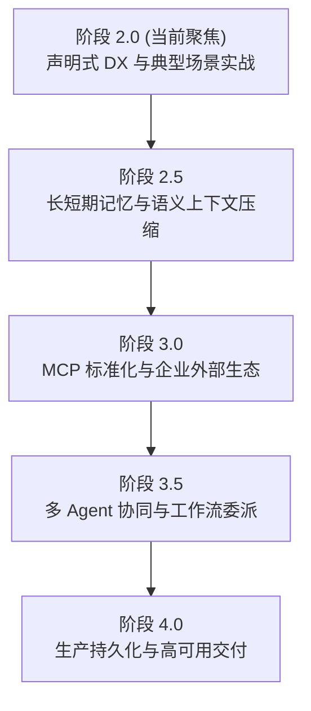

# Agent SDK 架构体系与未来演进路线规划

> [!IMPORTANT]
> **架构规划更新声明（2026-10-07 评审共识）**：  
> 本文档是早期的全景技术架构设想。在经过最新实战检验与架构评审后，已达成明确共识：
> 1. **核心定位收敛**：SDK 坚守**单 Agent 高可靠确定性执行引擎**定位，坚决不内置多 Agent Swarm 工作流调度平台（原阶段 3.5 内容）与分布式强一致事务持久化平台（原阶段 4.0 内容），相关编排与持久化完全解耦并移交宿主应用系统负责。
> 2. **最新业务设计卡与场景指引**：详见 **[使用场景手册.md](使用场景手册.md)**。
> 3. **最新实战路线图（P0~P3）与质量基线**：详见 **[演进建议.md](演进建议.md)**。

> **文档定位**：本文档是早期规划参考。明确 SDK 诞生初心、核心技术定位、已完成能力资产与架构分层。

---

## 一、 为什么做 Agent SDK：初心与问题定义

### 1.1 核心痛点与初心
在实际落地 AI 智能体的过程中，我们往往面临多样化的业务诉求：
- 企业内部 IT 运维与排障 Copilot（重日志分析、SOP 检索、高危重启审批）
- 企业内部 CRM 客户关系与商机挖掘 Agent（重大数据处理、工作区外溢、结构化报表）
- 消费端智慧酒店管家 / 餐饮预订 Agent（重房型查询、意图追问澄清、全额退款人工审批）

如果每做一个业务场景，都要重新手写一套：
- ReAct 思考-行动-观察驱动循环
- 会话生命周期与超时驱逐
- Token 估算与超大工具输出工作区外溢
- 全双工实时流式响应与思维链输出
- 高危写操作人工审批挂起与恢复

那么项目开发将陷入海量低水平样板代码的泥潭中。

**SDK 的诞生初心就是一句话：**
> **“业务场景可以随时切换，但底层的确定性 ReAct 执行循环、上下文工程、安全网关、状态流转与资源生命周期，必须沉淀为一套即插即用、开箱即用的通用内核 SDK。”**

### 1.2 与现有框架（LangChain4j / Spring AI）的本质差异
很多人会问：市面上已经有了 LangChain4j、Spring AI，为什么还要自研 Agent SDK？

| 核心维度 | LangChain4j / Spring AI | 我们的 Agent SDK |
| :--- | :--- | :--- |
| **技术定位** | LLM 客户端门面（Prompt 模板、API 调用抽象） | **企业级可靠确定性 ReAct 执行引擎内核** |
| **执行可靠性** | 基础 ReAct 循环，容易出现死循环或 Token 爆炸 | **原生防死循环、严格工具调用预算、重试退避与确定性停止边界** |
| **大输出外溢沙箱** | 简单截断或报异常 | **原生工作区沙箱：大输出自动外溢落盘，仅向模型投递精简索引与摘要** |
| **高危操作审批 (HITL)** | 无原生支持，业务需在外部侵入式硬编码挂起逻辑 | **原生支持 `RiskLevel`、`WAITING_APPROVAL`、`approve()` / `reject()` 挂起与恢复** |
| **目标管理与纠偏** | 纯静态 Prompt，无法运行时纠偏 | **原生结构化 `TaskBrief`，支持多轮交互中动态修正目标与约束 (`reviseGoal`)** |
| **生产级会话治理** | 缺乏会话 TTL 与主动内存驱逐，长期运行存在 OOM 隐患 | **原生会话空闲超时 (`waitingTimeout`)、容量上限 (`ensureCapacity`) 与临时沙箱自动清理** |

---

## 二、 整体四层架构蓝图

为了让业务开发从“繁琐的配置与底层编写”降维到“几行注解即可完成一个场景”，SDK 采用清晰的四层架构设计：

```
┌────────────────────────────────────────────────────────────────────────┐
│                        Agent SDK 总体四层架构蓝图                       │
├────────────────────────────────────────────────────────────────────────┤
│  L4. 企业级运营与可观测层 (Enterprise Governance & Observability)        │
│      - 统一 OpenTelemetry Trace / Span 导出                           │
│      - 审计回放 (Run Snapshot Replay) 与合规风控大盘                   │
├────────────────────────────────────────────────────────────────────────┤
│  L3. 业务场景预制套件层 (Domain Scenario Starters & Templates)          │
│      - [客服/服务型]: IT 支持专家、智慧酒店管家、餐饮预订助手              │
│      - [分析/洞察型]: CRM 商机挖掘助手、财务审计与大文件分析专家          │
├────────────────────────────────────────────────────────────────────────┤
│  L2. 开发者体验与声明式装配层 (Developer Experience & Starter)          │
│      - @AgentTool + @ToolParam 注解：方法直转 JSON Schema，自动类型反序列化 │
│      - ScenarioPlugin.builder("id") 链式流式装配器                      │
│      - @AgentComponent 与 Spring Boot Starter 自动发现与注册            │
├────────────────────────────────────────────────────────────────────────┤
│  L1. 通用 Agent 执行内核 (Agent Core Engine) [纯 Java 21, 零多余依赖]   │
│      - 上下文工程与预算控制 (TokenEstimator, ContextBudget, File Offloading)  │
│      - 全双工实时流式 (Token, Thought, ToolCall, Approval, Status)     │
│      - 动态目标简报与计划 (TaskBrief, Dynamic Goal Revision, TaskPlan)  │
│      - 会话生命周期与沙箱治理 (waitingTimeout, LRU Eviction, Temp Cleanup)│
│      - 人机协同安全网关 (RiskLevel, WAITING_APPROVAL, approve/reject)    │
└────────────────────────────────────────────────────────────────────────┘
```

---

## 三、 已完成核心能力资产（Phase 1 里程碑）

截至当前版本，SDK 已完成全部 5 大内核底座与声明式开发增强，所有模块测试均 100% 通过（97+ 个核心单测，下游应用零破坏兼容）：

### 3.1 五大引擎级底座
1. **上下文工程与外溢沙箱**：
   - 实现了双语优化的 `TokenEstimator` 与严格的 `ContextBudget`。
   - 当工具输出超过预算时，自动存入 `WorkspaceSession` 磁盘沙箱并返回带行号的结构化索引，彻底阻断 Token 爆炸。
2. **实时全双工流式响应**：
   - 支持 SSE / WebSocket 实时推流，支持 `TOKEN`、`THOUGHT`、`TOOL_CALL`、`TOOL_RESULT`、`WAITING_APPROVAL` 等细粒度分块。
3. **结构化目标与运行时纠偏**：
   - 引入 `TaskBrief` 管理结构化目标、约束与关键交付物。
   - 支持多轮会话中的动态目标变更 (`reviseGoal`)，并在用户变更目标时自动作废过期挂起审批。
4. **会话生命周期与资源治理**：
   - 支持等待输入与审批的空闲超时自动清理机制 (`waitingTimeout`)。
   - 提供 `ensureCapacity` 基于 LRU 淘汰机制限制活跃会话总数，防止内存泄漏。
   - 会话结束或异常终止时，自动安全清理工作区 `.temp/` 临时文件，仅持久化关键交付物。
5. **人机协同安全网关 (HITL)**：
   - 动作支持 `RiskLevel.READ_ONLY` 与 `RiskLevel.HIGH_RISK` 分类。
   - 遇到高危工具调用时，引擎自动拦截并挂起为 `WAITING_APPROVAL` 状态，暴露 `approve(runId, approvalId)` 和 `reject(runId, approvalId, reason)` 标准运维接口。

### 3.2 极简开发者体验增强 (DX)
1. **`@AgentTool` & `@ToolParam` 注解驱动**：
   - 开发者仅需在业务 Service 方法上打上注解，SDK 自动利用反射分析参数并生成标准的 Draft 2020-12 JSON Schema。
   - 自动支持 Java 原生类型、包装类型、Enum（自动生成 枚举数组 并支持大小写自适应）、List/Array 集合、复杂 POJO/Record。
   - 支持框架级隐式参数注入（如参数包含 `ToolContext` 时自动注入运行上下文，不暴露至 LLM Schema）。
   - 自动将方法异常捕获为确定性的 `ToolOutcome.Failure`，保证循环永不崩溃。
2. **`ScenarioPlugin.builder()` 极简装配器**：
   - 彻底免去手写 `ScenarioPlugin` 实现类的繁琐样板，支持 `.addAnnotatedTools(myService)` 5 行代码完成场景组装。
3. **`@AgentComponent` Spring Boot 自动装配**：
   - 与 Spring 容器深度融合，支持组件扫描与依赖注入。

---

## 四、 SDK 未来演进路线图（按阶段规划）

后续演进路线采取 **“场景拉动 + 平台沉淀”** 双轮驱动，整体分为四个演进阶段：



### 阶段 2.0：声明式 DX 与典型场景实战（当前阶段）
- **核心目标**：用 2 个差异极大的业务场景，充分检验并验证 SDK 的通用性与开发爽感。
- **关键任务**：
  1. **构建「智慧酒店管家场景」**：
     - 使用 `@AgentTool` 编写客房查询（低危）、客房服务（常规）与订单退款（高危 HITL）。
     - 验证前端与流式打字机、高危审批卡片的端到端交互。
  2. **构建「CRM 商机挖掘场景」**：
     - 编写海量客户跟进记录分析工具，利用 `WorkspaceSession` 文件外溢沙箱进行大文本摘要与商机评级。
     - 验证 `TaskBrief` 在长任务交付物审查中的落地效果。
  3. **增强 DX 脚手架**：
     - 支持从 OpenAPI / Swagger JSON 直接自动导出 `@AgentTool` 契约代码。

### 阶段 2.5：长短期记忆与语义上下文压缩
- **核心目标**：突破单会话 Token 窗口限制，支持多轮深度对话与跨会话用户偏好沉淀。
- **关键任务**：
  1. **`MemoryProvider` 统一抽象**：
     - 提供纯接口抽象，与具体向量库（Milvus / PgVector / RedisSearch / InMemory）解耦。
  2. **短期对话语义窗口滑动压缩**：
     - 当历史会话轮次超过阈值时，自动调用轻量模型将早期轮次压缩为结构化事实摘要（Summary Compaction），保持上下文小巧。
  3. **跨会话长期记忆（Profile & Long-term Memory）**：
     - 自动抽取用户偏好（如“张先生喜欢无烟房高楼层”、“李经理关注金融行业商机”），在新会话初始化时注入系统提示词。

### 阶段 3.0：MCP 标准化与企业能力生态 (Model Context Protocol & Skills)
- **核心目标**：兼容行业标准协议，让 SDK 能够无缝接入业界海量工具与 Skills。
- **关键任务**：
  1. **MCP (Model Context Protocol) 官方客户端集成**：
     - 提供 `McpToolAdapter`，支持将外部标准 MCP Server（文件系统、Git、PostgreSQL、Puppeteer）直接桥接为 SDK 的 `Tool`。
  2. **企业级 Skills 规范**：
     - 支持以 Markdown 形式定义复合技能包，模型可通过调用技能解释器按步骤执行 SOP。

### 阶段 3.5：多 Agent 协同与工作流委派 (Multi-Agent Swarm)
- **核心目标**：解决单 Agent 能力边界受限、提示词互相污染的问题，支持复杂大任务分工。
- **关键任务**：
  1. **主从委派模式 (Supervisor - Worker)**：
     - 主 Agent 负责任务拆解与最终汇报，将子任务通过 `delegateTask(subAgentId, input)` 委派给专业子 Agent（如“日志诊断专家”、“计费结算专家”）。
  2. **跨 Agent 隔离沙箱**：
     - 每个子 Agent 拥有独立的会话、工具集与预算控制，避免 Prompt 混淆。
  3. **协同追踪链路**：
     - 在事件流与 Trace 中打通父子 Run ID，实现全链路调用图谱可视化。

### 阶段 4.0：生产持久化与高可用交付 (Production Resilience)
- **核心目标**：从单机内存原型迈向金融级高可用生产部署。
- **关键任务**：
  1. **状态机外置持久化 (State Persistence)**：
     - 提供 `RunRepository` 接口，支持将 `RunSnapshot` 与会话事件流实时刷盘至数据库（PostgreSQL / MySQL / Redis）。
     - 支持服务器重启或 Pod 迁移后的断点恢复（Resume from Snapshot）。
  2. **分布式锁与并发防重**：
     - 引入分布式运行锁，确保同一个会话的并发请求严格串行排队。
  3. **统一 OpenTelemetry 观测套件**：
     - 原生导出 W3C TraceContext 与 OTel Metrics（Token 消耗、工具耗时、异常率、审批挂起时长）。
     - 提供即插即用的前端监控大盘与审计回放能力。

---

## 五、 核心设计准则（永不妥协的技术红线）

为了确保 SDK 在长期演进过程中不腐化、不变质，所有后续提交必须严格遵守以下原则：

1. **零多余外部依赖 (Minimal External Dependencies)**：
   - `agent-core` 必须保持纯粹的 Java 21 实现，除了基础的 `jackson` 与 `json-schema-validator` 外，坚决不引入任何三方框架。Spring AI 适配、数据库适配必须下沉至独立的扩展子模块。
2. **向后兼容与契约稳定性 (Backward Compatibility)**：
   - 所有公共接口（`AgentRunner`、`RunSnapshot`、`RunLimits`、`Tool`）的升级必须采用默认方法（Default Method）或重载构造函数，严禁破坏下游已上线场景。
3. **确定性与防御性优先 (Determinism First)**：
   - 模型输出永远是不可控的，必须通过 JSON Schema 严格校验、工具预算硬限制、超时强制中断和安全审批网关，构筑坚不可摧的工程护栏。
4. **场景驱动演进 (Scenario-Driven Iteration)**：
   - 坚决杜绝“为了架构而架构”的自嗨式设计。每一个新增的核心特性，必须在具体的业务场景（酒店、IT、CRM）中经过实战检验和痛点验证。
