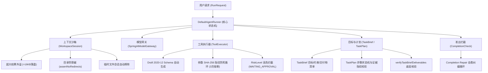

# Agent SDK 现状评估与演进完善技术提案 (v1.2.0 Proposal)

- **提案日期**：2026-10-23
- **适用版本**：`agent-sdk: 1.1.0-SNAPSHOT` $\to$ `1.2.0`
- **文档密级**：内部技术评审与架构决策
- **涉及模块**：`agent-core`、`agent-spring-boot-starter`、`agent-samples`

---

## 1. 项目整体现状审计 (Current Baseline)

当前 `agent-sdk` 已完成作为**企业级单 Agent 确定性执行引擎与中间件开发套件**的底层建设，具备了坚实的高可靠运行时基座。

### 1.1 核心层已有能力矩阵（源码可验证）



1. **确定性 ReAct 执行循环**：自主掌控模型与工具交互，彻底剥离第三方框架自带的黑盒循环，支持微秒级活跃耗时（`activeTime`）、模型耗时（`modelTime`）与等待耗时（`waitingTime`）分段审计。
2. **生命周期状态机**：完整覆盖 `RUNNING`、`WAITING_INPUT`（意图澄清挂起）、`WAITING_APPROVAL`（高危审批挂起）、`COMPLETED`、`STOPPED` 等 7 种状态，支持异步恢复（`resume` / `approve` / `reject`）。
3. **上下文沙箱与防爆外溢（Safe Spillover）**：隔离的 `WorkspaceSession`，当工具输出超过阈值（16KB）自动安全落盘转存，仅回传分页便利贴，彻底阻断大模型 Token 撑爆崩溃。
4. **结构化契约与计划（TaskBrief / TaskPlan）**：SDK 原生支持目标版本演进（`goalVersion`）、步骤状态机与证据绑定（`evidenceRefs`），并在底层内置了交付物文件与版本的自动比对。
5. **协议与外部生态（agent-mcp-adapter）**：基于 Java 21 虚拟线程（Virtual Threads）实现轻量 MCP 客户端，通过 `ProcessHandle.descendants()` 进程看门狗机制彻底解决外部工具僵尸进程泄漏难题。

---

## 2. 当前存在的痛点与架构缺口 (Pain Points & Gaps)

尽管 SDK 底层功能完备，但在**应用层业务落地**与**部分元数据解耦**上，暴露出以下 3 个关键瓶颈：

### 痛点 1：应用层交付物验收规则极易退化为“面条式脆皮代码”
* **现象**：业务开发者在实现 [`CompletionCheck`](file:///D:/agent/agent-sdk/agent-core/src/main/java/com/agent/agentcorelab/agent/CompletionCheck.java) 接口时，由于没有现成的规则组合脚手架，往往编写多达 100~200 行包含 `goal.contains("分析")`、`goal.contains("你好")` 的自然语言关键字匹配。
* **风险**：
  - **误判率高**：用户提问“请分析为什么客服打招呼会报错”，同时命中“分析”与“打招呼”，导致任务逻辑错乱。
  - **难以维护**：随着业务场景增多，if-else 爆炸，单测极难编写。

### 痛点 2：工具缺乏语义能力标签（Tool Capability Tags），业务校验产生强耦合
* **现象**：当前 [`ToolDefinition`](file:///D:/agent/agent-sdk/agent-core/src/main/java/com/agent/agentcorelab/tool/ToolDefinition.java) 仅包含 `name`、`description`、`inputSchema` 与 `riskLevel`，缺少通用的标签机制。应用层在校验工具履历时，只能硬编码写死工具名：
  ```java
  obs.call().name().equals("executeSafeSql") || obs.call().name().equals("queryDataDictionary")
  ```
* **风险**：底层工具一旦重命名（如改成 `executeClickHouseSql`）或通过 MCP 动态接入新工具，上层验收断言全部静默失效。

### 痛点 3：SDK 底层优秀能力（TaskBrief / TaskPlan）未与应用层开箱打通
* **现象**：SDK 底层其实已经内置了强大的 `TaskBrief`（交付物清单）和 `TaskPlan`（步骤状态机），但应用层不知道如何便捷地将其引入，依然习惯于事后去猜大模型的调用步骤。

---

## 3. 未来演进完善方案设计 (Detailed Technical Design)

本提案建议在 `1.2.0` 版本中引入两项**无破坏性、极致轻量**的核心增强特性，并配套重构官方最佳实践样例：

### 提案 1：工具元数据标签与能力解耦 (Tool Capability Tagging)

#### 3.1.1 改造 `@AgentTool` 注解
在 [`AgentTool.java`](file:///D:/agent/agent-sdk/agent-core/src/main/java/com/agent/agentcorelab/tool/annotation/AgentTool.java) 中增加 `tags` 属性：
```java
public @interface AgentTool {
    String name() default "";
    String description();
    RiskLevel riskLevel() default RiskLevel.READ_ONLY;
    
    /**
     * 业务能力标签（如 "DATA_QUERY", "METADATA_INSPECTION", "EXPORT" 等）
     */
    String[] tags() default {};
}
```

#### 3.1.2 增强 `ToolDefinition` 与 `Observation`
在 [`ToolDefinition.java`](file:///D:/agent/agent-sdk/agent-core/src/main/java/com/agent/agentcorelab/tool/ToolDefinition.java) 中增加不可变的 `Set<String> tags`，并保留现有构造器实现 100% 向后兼容：
```java
public record ToolDefinition(
    String name, 
    String description, 
    String inputSchema, 
    RiskLevel riskLevel,
    Set<String> tags
) {
    // 兼容老版本的 4 参构造器
    public ToolDefinition(String name, String description, String inputSchema, RiskLevel riskLevel) {
        this(name, description, inputSchema, riskLevel, Set.of());
    }

    public boolean hasTag(String tag) {
        return tags.contains(tag);
    }
}
```
同时在 `RunSnapshot.Observation` 中透出 `hasTag(String tag)` 便捷方法。

> **重构后效果**：应用层断言不再依赖具体方法名：
> ```java
> boolean hasDataQueried = run.observations().stream()
>     .anyMatch(obs -> obs.hasTag("DATA_QUERY") && obs.outcome().isSuccess());
> ```

---

### 提案 2：SDK 内置责任链组合验收器 (Composite Completion Check)

在 `agent-core` 的 `com.agent.agentcorelab.agent` 包中，新增开箱即用的组合规则器 [`CompositeCompletionCheck`](file:///D:/agent/agent-sdk/agent-core/src/main/java/com/agent/agentcorelab/agent/CompositeCompletionCheck.java)。

#### 3.2.1 核心实现设计
```java
package com.agent.agentcorelab.agent;

import com.agent.agentcorelab.agent.run.RunSnapshot;
import java.util.List;
import java.util.Objects;

/**
 * 责任链组合验收器：将庞大的 if-else 拆解为单一职责的合规断言规则卡片。
 */
public final class CompositeCompletionCheck implements CompletionCheck {

    private final List<CompletionCheck> checks;

    public CompositeCompletionCheck(List<CompletionCheck> checks) {
        this.checks = List.copyOf(Objects.requireNonNull(checks, "checks cannot be null"));
    }

    public static CompositeCompletionCheck of(CompletionCheck... checks) {
        return new CompositeCompletionCheck(List.of(checks));
    }

    @Override
    public Result check(RunSnapshot run, String finalAnswer) {
        for (CompletionCheck check : checks) {
            Result result = check.check(run, finalAnswer);
            if (!result.complete()) {
                return result; // 短路返回第一项不合规原因
            }
        }
        return Result.satisfied();
    }
}
```

#### 3.2.2 提供 3 个通用的开箱即用规则实现（Built-in Rules）
1. **`RequiredToolTagCheck(String tag, String errorMessage)`**：断言必须成功执行过至少一个包含指定 Tag 的工具。
2. **`TaskPlanCompletedCheck(String errorMessage)`**：断言如果存在 `TaskPlan`，计划中所有步骤必须全部为 `DONE` 状态。
3. **`DeliverableArtifactsCheck()`**：调用底层 `verifyTaskBriefDeliverables`，断言交付物物理存在且版本匹配。

> **重构后效果**：应用层的验收逻辑转变为声明式的积木拼装：
> ```java
> @Bean
> public CompletionCheck troubleshootingCompletionCheck() {
>     return CompositeCompletionCheck.of(
>         (run, answer) -> answer.isBlank() ? Result.incomplete("结论不能为空") : Result.satisfied(),
>         new RequiredToolTagCheck("DATA_QUERY", "排障过程必须包含真实数据查询凭据！"),
>         new TaskPlanCompletedCheck("排障分析步骤尚未全部推进完毕！")
>     );
> }
> ```

---

### 提案 3：重构现有 Samples 样例代码，打造官方最佳实践标杆

将 `agent-samples` 现有的 `DataAnalysisScenario` 和应用层校验代码，彻底重构掉基于自然语言关键字匹配的陈旧做法，全面切换为：
- 采用 `@AgentTool(tags = {"DATA_QUERY"})`；
- 采用 `TaskBrief.of(...)` 传递显式交付清单；
- 采用 `CompositeCompletionCheck` 规则链。

---

## 4. 方案影响与评估矩阵 (Evaluation Matrix)

| 评估维度 | 评估结果 | 详细分析 |
| :--- | :---: | :--- |
| **向后兼容性 (Compatibility)** | **100% 兼容** | 现有所有类均保留旧构造函数与默认行为；不强制使用 Tags；不强制使用 Composite；现有业务代码一行不改依然能跑。 |
| **代码改动范围 (Diff Scope)** | **极轻量 (<150行)** | 涉及 4 个现有文件修改、新增 2 个核心类，无任何第三方依赖引入，维持 `agent-core` 的极致纯净。 |
| **架构收益 (Architecture Gain)** | **极高** | 彻底切断应用层验收与底层方法名的强耦合；消灭自然语言猜测意图的脆弱逻辑；极大降低企业级接入成本。 |
| **实施成本与周期 (Effort)** | **0.5 ~ 1 人日** | 核心实现约 1 小时，单元测试覆盖（保持 100% 覆盖率）约 2 小时，代码评审与发布验证约 2 小时。 |
| **实施风险 (Risk)** | **极低 (Low)** | 不触碰 `DefaultAgentRunner` 状态机主循环核心调度流程，仅增强元数据与校验 SPI 接入层。 |

---

## 5. 会议评审决策建议 (Recommendations)

建议在技术评估会议上，按以下三种选项进行决议：

* **选项 A（强烈推荐：批准并执行实施）**：
  - 立即立项并实施提案 1 与提案 2（工期 0.5 天），合并入 `v1.2.0-SNAPSHOT`；
  - **面试价值**：不仅能讲述项目已有亮点，更能向面试官清晰演示“从发现面条代码问题到架构解耦落地”的完整闭环，极具技术说服力。

* **选项 B（仅作为架构演进储备，暂不合入主干）**：
  - 代码暂不修改，保留当前 `v1.1.0-SNAPSHOT` 状态；
  - **面试策略**：在面试中直接把本提案作为“**架构演进与技术规划**”向面试官推演汇报，证明自己具备前瞻性的系统架构设计与重构能力。

* **选项 C（维持现状，完全由应用层自行封装）**：
  - 认定 SDK 保持绝对极简，将责任链与标签逻辑完全交由业务微服务层自行编写。
