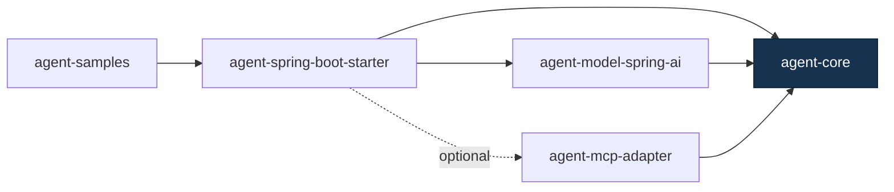
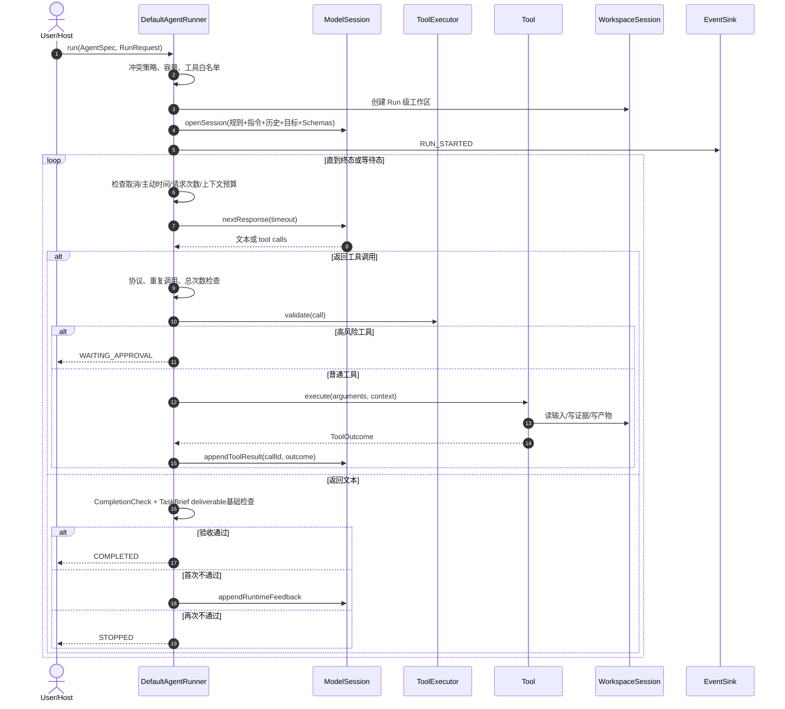
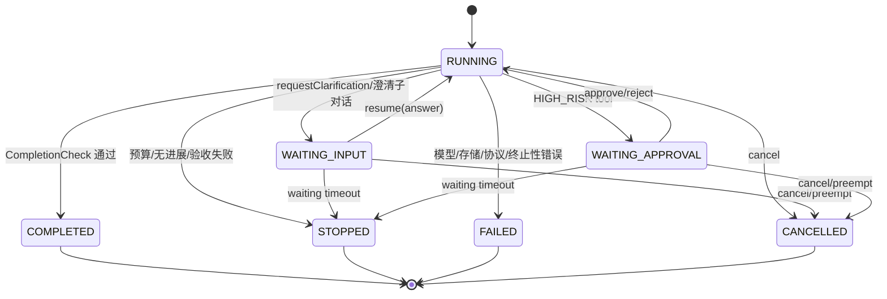
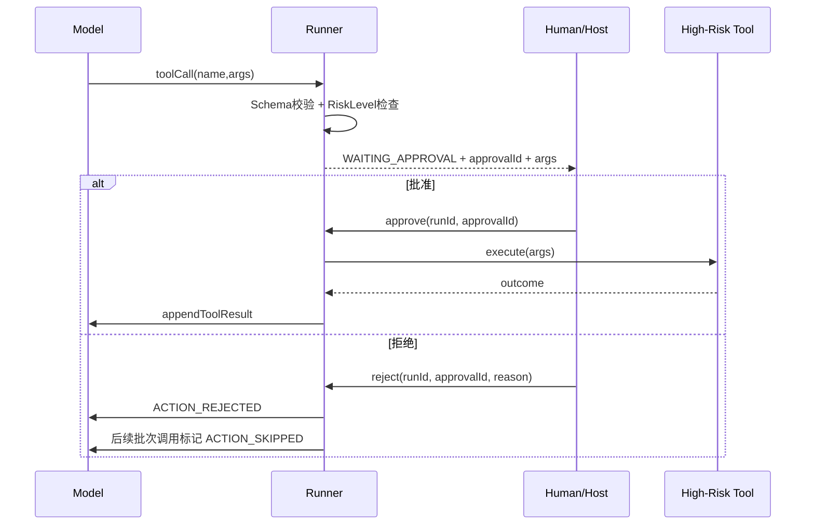

# Agent SDK 面试指南

> 适用项目：`agent-sdk 1.1.0-SNAPSHOT`  
> 源码基线：2026-10-22，`master` 分支，HEAD `7e64105`  
> 文档定位：帮助项目负责人从“会介绍”进阶到“能解释设计、能读源码、能应对追问”  
> 事实原则：源码与测试优先；“已实现”“已知局限”“提议路线”严格分开

---

## 目录

1. [先记住这张项目名片](#1-先记住这张项目名片)
2. [面试表达与简历口径](#2-面试表达与简历口径)
3. [项目背景、问题与定位](#3-项目背景问题与定位)
4. [技术栈与模块架构](#4-技术栈与模块架构)
5. [核心领域模型](#5-核心领域模型)
6. [一次 Agent 运行的完整链路](#6-一次-agent-运行的完整链路)
7. [核心源码深挖](#7-核心源码深挖)
8. [Spring AI 模型适配层](#8-spring-ai-模型适配层)
9. [工具系统与声明式工具](#9-工具系统与声明式工具)
10. [Workspace、证据与产物](#10-workspace证据与产物)
11. [记忆、上下文与压缩](#11-记忆上下文与压缩)
12. [HITL 审批与运行治理](#12-hitl-审批与运行治理)
13. [MCP 与 Skills](#13-mcp-与-skills)
14. [Spring Boot Starter](#14-spring-boot-starter)
15. [流式输出、可观测与指标](#15-流式输出可观测与指标)
16. [可靠性、安全性与边界](#16-可靠性安全性与边界)
17. [测试体系与工程化](#17-测试体系与工程化)
18. [关键设计取舍](#18-关键设计取舍)
19. [已知缺陷与改进方向](#19-已知缺陷与改进方向)
20. [高频面试题与参考回答](#20-高频面试题与参考回答)
21. [项目难点的 STAR 表达](#21-项目难点的-star-表达)
22. [源码导读路线](#22-源码导读路线)
23. [现场画图模板](#23-现场画图模板)
24. [复习计划与自测清单](#24-复习计划与自测清单)
25. [一页面试速查表](#25-一页面试速查表)

---

# 1. 先记住这张项目名片

## 1.1 一句话定义

**Agent SDK 是一个可嵌入 Java/Spring Boot 应用的单 Agent 确定性执行运行时。它把模型调用、工具执行、状态机、预算控制、澄清、人工审批、工作区证据和运行观测统一到一个由 SDK 掌控的执行循环中。**

这里有三个关键词：

- **单 Agent**：不是多 Agent 编排器，也不是工作流平台。
- **确定性执行**：不是说大模型输出确定，而是说工具执行权、状态迁移、预算、审批、错误处理由程序控制。
- **可嵌入运行时**：它是库，不是独立 SaaS 平台；宿主应用负责业务身份、业务工具、页面和部署。

## 1.2 30 秒回答

> 我做的是一个 Java Agent SDK，定位是单 Agent 的确定性执行引擎。它不让模型或 Spring AI 自己执行工具，而是由 Runner 统一掌控 ReAct 循环：模型只提出工具调用，SDK 完成白名单检查、JSON Schema 校验、预算控制、高风险审批、工具执行、结果回填和完成验收。项目拆成 core、Spring AI 模型适配、MCP 适配、Spring Boot Starter 和 samples 五个模块，核心价值是让 Agent 的运行过程可控、可暂停、可观测，而不是单纯封装一次大模型请求。

## 1.3 2 分钟回答

> 这个项目源于一个问题：直接调用大模型很容易做出 Demo，但进入业务系统后，谁来控制工具调用、怎么防止无限循环、怎么限制上下文、何时要求人工审批、怎么证明任务真的完成，这些都需要一个程序化运行时。
>
> 所以我把 SDK 的核心设计成一个外层执行循环。`AgentSpec` 描述指令、工具白名单、预算、完成检查和执行策略；`DefaultAgentRunner` 维护七种运行状态，驱动模型与工具交替执行；`ToolExecutor` 负责 Schema 校验和结果协议；`WorkspaceSession` 负责输入边界、证据、产物和大结果外溢；高风险工具会把运行挂起到 `WAITING_APPROVAL`；缺少信息时会进入 `WAITING_INPUT`。模型层通过 `ModelGateway` 解耦，当前实现基于 Spring AI 的 OpenAI 兼容模型，但工具执行权仍只属于 Runner。
>
> 工程上项目拆成五个 Maven 模块，并提供 Spring Boot 自动装配、MCP stdio 工具桥接、JSONL 事件、Micrometer 指标和两个样例场景。现存 Surefire 报告统计为 380 次测试执行、0 failure/error、1 skipped，但目前还没有生产部署和真实业务基线，所以我会把它描述为机制较完整的运行时原型，而不会夸大为已经生产验证的平台。

## 1.4 五个最值得讲的亮点

| 亮点 | 核心做法 | 面试价值 |
| --- | --- | --- |
| 执行权唯一 | 模型只生成调用意图，Runner 执行工具 | 能解释 Agent 与普通 Chat API 的差异 |
| 显式状态机 | 运行、等输入、等审批、完成、停止、失败、取消 | 能解释长流程、人机协同和可恢复边界 |
| 多层预算与防失控 | 模型次数、工具次数、重复调用、连续错误、上下文、主动时间 | 能解释可靠性，不只谈 Prompt |
| 证据化交付 | Workspace、Evidence ID、Artifact digest、CompletionCheck | 能解释如何减少“口头完成”和幻觉 |
| 可插拔集成 | Model、Tool、Memory、Event、Scenario、MCP、Starter | 能解释模块化和框架设计 |

## 1.5 当前事实基线

| 项目 | 当前事实 |
| --- | --- |
| 版本 | `1.1.0-SNAPSHOT` |
| JDK | Java 21，Maven Enforcer 强制 JDK 21+ |
| Spring Boot | 4.1.1 |
| Spring AI | 2.0.1 |
| 模块 | `agent-core`、`agent-model-spring-ai`、`agent-mcp-adapter`、`agent-spring-boot-starter`、`agent-samples` |
| 模型范围 | 当前实现面向 OpenAI 兼容接口，不是任意模型统一适配 |
| MCP 范围 | MCP `2024-11-05`，stdio/in-memory；未支持远程 HTTP/OAuth |
| 并发范围 | 单个 Runner 同时只执行一个任务；Starter 当前默认注册单例 Runner |
| 持久化范围 | 会话记忆可内存或文件；运行状态与审批不支持进程重启恢复 |
| 评测范围 | 有外部评测工程和 smoke 记录，但没有真实业务 Track B 基线 |
| 测试证据 | 2026-10-18 现存 Surefire XML：380 次执行，0 failure/error，1 skipped；不是本文编写时重新构建的结果 |

---

# 2. 面试表达与简历口径

## 2.1 最重要的表达原则

1. **先讲问题，再讲技术。** 不要上来背类名。
2. **把“模型智能”和“运行时治理”分开。** 模型负责提议，程序负责执行边界。
3. **把“确定性”说准确。** 确定的是控制流程，不是模型输出。
4. **把“已实现”和“规划”分开。** 可信上下文、审批持久化、OTel、官方 MCP SDK 替换仍是规划。
5. **不要虚构生产事故、用户量或线上指标。** 当前没有生产部署证据。
6. **不要用测试数量代替业务价值。** 380 次测试执行说明机制覆盖，不说明真实业务效果。
7. **对 AI 辅助开发保持诚实。** 可以说自己主导需求、架构、取舍和验收，并使用 AI 提升编码效率；关键是能解释代码和判断实现是否正确。

## 2.2 推荐简历描述

### 稳健版

> 主导设计并实现一套基于 Java 21、Spring Boot 与 Spring AI 的单 Agent 执行 SDK，抽象模型、工具、场景、记忆与观测 SPI；实现显式运行状态机、工具 Schema 校验、预算与循环控制、HITL 高风险审批、工作区证据与大结果外溢，并提供 MCP stdio 适配和 Spring Boot 自动装配。

### 两条成果版

- 设计由 SDK 掌控的 Agent 执行循环，将模型工具调用意图与真实执行解耦，统一处理白名单、Schema 校验、调用预算、重复调用检测、取消、澄清和人工审批。
- 通过五模块 Maven 架构提供 Spring AI 模型适配、MCP stdio 工具桥接、Spring Boot 自动配置、JSONL/Micrometer 观测与样例场景；建立单元、契约、loopback 协议和自动配置测试体系。

### 不推荐的表述

- “生产级/金融级 Agent 平台”——没有生产验证和完整信任边界。
- “支持所有大模型”——当前是 OpenAI 兼容接口。
- “支持完整 MCP”——当前协议旧且仅 stdio/in-memory。
- “精确 Token 预算”——当前是估算，计费应以模型 usage 为准。
- “支持多 Agent”——明确不支持，也不应包装成支持。
- “完全防止 Prompt Injection”——只有规则、白名单和边界，不是完整防护体系。

## 2.3 “你在项目中负责什么”

建议如实回答：

> 我主要负责问题定义、架构边界、核心机制设计、技术选型和交付验收，编码过程中大量使用了 AI 辅助。我不会把每一行都说成纯手写，但核心类、运行链路、设计取舍和已知缺陷我都能解释，也会通过源码、测试报告和 Git 状态核验 AI 的交付，而不是直接接受生成结果。

这比声称“所有代码都是手写”更可信，也能把 AI 辅助开发转化成工程能力：

- 能否定义清楚需求；
- 能否约束生成范围；
- 能否发现错误和夸大；
- 能否设计验收证据；
- 能否维护模块边界。

## 2.4 面试中的三层回答法

任何技术问题都按三层回答：

1. **结论**：一句话回答是什么。
2. **机制**：说明关键对象和流程。
3. **权衡**：说明为什么这么做、代价是什么。

示例：

> 为什么不让 Spring AI 自动执行工具？  
> **结论**：因为 SDK 需要统一掌握执行权。  
> **机制**：Spring AI 只接收 Schema 并返回 tool call，Runner 做校验、预算、审批、执行和结果回填。  
> **权衡**：控制力更强，但模型适配层更复杂，也需要自己维护协议和流式处理。

---

# 3. 项目背景、问题与定位

## 3.1 要解决的问题

普通 Chat 调用大致是：

```text
用户输入 → 模型 → 文本输出
```

Agent 运行则是：

```text
用户目标 → 模型判断 → 工具调用 → 外部世界变化/查询结果
         → 模型继续判断 → 最终交付
```

一旦模型能调用工具，就会出现一组传统 Chat API 没有的问题：

- 模型是否调用了未授权工具？
- 参数是否合法？
- 是否在重复调用同一个工具？
- 调用失败后会不会死循环？
- 高风险写操作是否经过人工审批？
- 上下文是否会被巨大工具结果撑爆？
- 模型声称完成时，产物是否真的存在？
- 用户补充信息或修改目标后，原任务如何继续？
- 运行过程是否可以观测和追责？

Agent SDK 的核心价值就是把这些问题变成程序化规则，而不是完全寄希望于 Prompt。

## 3.2 项目定位边界

| SDK 是什么 | SDK 不是什么 |
| --- | --- |
| 单 Agent 执行运行时 | 多 Agent Supervisor/Swarm |
| 嵌入宿主应用的 Java 库 | 独立托管平台 |
| 管理一次运行的状态、预算、工具和等待点 | 任务队列、调度平台 |
| 提供工具与模型适配契约 | 业务权限系统、IdP |
| 提供运行事件和指标 | 完整运维平台 |
| 提供 MCP 工具桥接 | MCP Server 托管平台 |
| 提供场景装配机制 | 行业知识库和业务产品 |

## 3.3 “确定性执行”到底指什么

不能说“大模型是确定性的”。正确说法是：

- 模型输出仍然具有概率性；
- 但是**允许哪些工具、执行什么参数、什么时候停止、何时审批、预算如何扣减、错误如何分类、结果如何回填**由代码决定；
- 同样的模型输出进入运行时后，会走可预测的校验和状态迁移。

因此更准确的词是：**确定性的控制面包裹概率性的模型决策。**

## 3.4 与工作流引擎的差异

| 维度 | Agent SDK | 传统工作流 |
| --- | --- | --- |
| 下一步 | 模型根据上下文动态选择 | 流程图预先定义 |
| 控制 | 预算、策略、状态机限制模型 | 节点和边固定 |
| 适合 | 开放式信息任务、动态工具选择 | 规则稳定、强确定业务流程 |
| 风险 | 不稳定、成本和安全边界复杂 | 灵活性不足 |
| 项目态度 | 单 Agent 内部可以动态决策 | 不在 core 内重建 Workflow 引擎 |

---

# 4. 技术栈与模块架构

## 4.1 技术栈

| 类别 | 技术 | 用途 |
| --- | --- | --- |
| 语言 | Java 21 | Record、现代语法、虚拟线程相关能力 |
| 构建 | Maven 多模块 | 模块聚合与依赖管理 |
| 应用框架 | Spring Boot 4.1.1 | Starter 与自动配置 |
| AI 框架 | Spring AI 2.0.1 | 模型消息、工具 Schema、OpenAI 模型抽象 |
| 模型 SDK | openai-java 4.49.0 | OpenAI 兼容调用底层能力 |
| HTTP | OkHttp 4.12.0 | 自定义模型 HTTP/SSE 传输 |
| JSON | Jackson 2.18.6 | 协议、工具参数和结果处理 |
| Schema | networknt JSON Schema Validator 1.5.6 | Draft 2020-12 参数校验 |
| 数据样例 | Apache Commons CSV 1.14.1 | CSV 分析样例 |
| 指标 | Micrometer（可选） | Agent 运行指标 |
| 协议 | MCP 2024-11-05 | stdio/in-memory 工具互操作 |

## 4.2 五模块职责



| 模块 | 主要职责 | 典型类 |
| --- | --- | --- |
| `agent-core` | 状态机、执行循环、工具契约、工作区、记忆、事件 | `DefaultAgentRunner`、`ToolExecutor`、`WorkspaceSession` |
| `agent-model-spring-ai` | OpenAI 兼容模型适配、SSE 解析、Token 估算 | `SpringAiModelGateway`、`OneShotHttpClient` |
| `agent-mcp-adapter` | MCP 客户端、传输、工具适配、Skills | `DefaultMcpClient`、`McpToolAdapter` |
| `agent-spring-boot-starter` | 自动配置、属性绑定、日志、指标、MCP 启动 | `AgentConfiguration`、`McpAutoConfiguration` |
| `agent-samples` | 文件检查与数据分析样例、CLI | `DataAnalysisScenario`、`AgentCli` |

## 4.3 为什么要拆模块

- `core` 不依赖 Spring Boot，便于单独使用和测试。
- 模型供应商变化不应侵入状态机。
- MCP 是可选能力，不应强迫所有消费者引入。
- Starter 只负责装配，不承载核心业务逻辑。
- Samples 是消费者视角示例，不应反向成为 core 依赖。

## 4.4 依赖倒置的体现

核心层通过接口依赖外部能力：

- `ModelGateway` / `ModelSession`：模型端口；
- `Tool` / `ToolCatalog`：工具端口；
- `ConversationMemory` / `UserProfileMemory`：记忆端口；
- `RunEventSink` / `RunEventListener`：观测端口；
- `CompletionCheck`：完成验收端口；
- `ScenarioPlugin`：场景装配端口。

这使状态机不必知道 OpenAI、MCP、Micrometer 或 Spring Bean 的细节。

---

# 5. 核心领域模型

## 5.1 `AgentSpec`：Agent 的静态定义

字段：

- `id`：符合 `[a-z][a-z0-9-]{0,63}`；
- `instructions`：场景指令；
- `toolNames`：工具白名单；
- `limits`：运行预算；
- `completionCheck`：完成验收；
- `policy`：活动任务冲突与澄清策略。

关键认识：`AgentSpec` 不是一个拥有线程的 Agent 对象，而是一次运行所需的**不可变规格**。

源码：`agent-core/.../agent/AgentSpec.java`。

## 5.2 `RunRequest`：一次运行的动态输入

包含：

- 用户目标；
- 工作区；
- 外部取消信号；
- 可选的结构化 `TaskBrief`；
- 可选 `conversationId`；
- 可选 `userId`。

当前缺口：没有 tenant、principal、scope、traceId 等可信上下文，因此不能把当前审批描述成完整企业授权。

## 5.3 `RunSnapshot`：对外只读快照

快照包含：

- `runId`、`agentId`、goal、status；
- 工具调用 observations；
- artifacts；
- metrics；
- 待回答问题；
- task brief、task plan；
- 待审批请求。

设计意义：把内部可变 `State` 与外部可读状态分离，减少调用方直接修改运行状态的风险。

## 5.4 `RunResult`：一次 API 调用的返回

`run/resume/approve/reject/reviseGoal` 每次都返回当前结果；结果可能不是终态，也可能是：

- `WAITING_INPUT`：等待用户回答；
- `WAITING_APPROVAL`：等待审批；
- `COMPLETED`：完成；
- `STOPPED`：被预算或规则停止；
- `FAILED`：不可恢复失败；
- `CANCELLED`：取消。

## 5.5 `ScenarioPlugin`：业务场景聚合

场景定义：

- 场景 ID、描述和指令；
- 允许使用的工具；
- 完成检查；
- 执行策略。

它的价值是把“通用运行时”与“业务场景”分离。同一个 Runner 可以装配文件检查、数据分析、技术支持等不同场景。

## 5.6 `CompletionCheck`：独立完成验收

模型输出“已经完成”并不等于真的完成。`CompletionCheck` 可以检查：

- 是否调用过必要工具；
- 是否生成真实 artifact；
- 是否满足业务结果；
- 是否只是中间解释。

三种结果：`COMPLETE`、`INCOMPLETE`、`INTERMEDIATE_EXPLANATION`。

注意：`ScenarioPluginBuilder` 默认 completion check 直接通过，只适合快速原型；正式场景应显式配置。

---

# 6. 一次 Agent 运行的完整链路

## 6.1 总体时序



## 6.2 启动阶段

`run()` 的主要动作：

1. 校验 `AgentSpec` 和 `RunRequest`；
2. 通过 `ExecutionPolicy` 处理当前任务冲突；
3. 检查 Runner 容量；
4. 将内置控制工具和场景工具组成白名单 Catalog；
5. 为本次运行创建 `ToolExecutor` 和内部 `State`；
6. 创建 `WorkspaceSession`；
7. 加载 conversation history 和 user profile；
8. 打开模型会话；
9. 写入 `RUN_STARTED` 事件；
10. 进入 `drive()` 主循环。

## 6.3 主循环阶段

循环每轮依次检查：

1. 是否取消；
2. 主动执行时间是否耗尽；
3. 模型请求次数是否耗尽；
4. 上下文是否超过 75% 阈值，是否能压缩；
5. 压缩后是否仍超过上下文预算；
6. 调用模型；
7. 校验 finish reason、callId、工具名、参数长度；
8. 工具分支或最终文本分支。

## 6.4 工具调用阶段

工具调用不是直接执行，必须经过：

```text
工具白名单
  → callId/名称/参数协议检查
  → 总工具次数检查
  → 重复调用指纹检查
  → JSON Schema 校验
  → 控制工具特殊处理
  → 高风险审批检查
  → ToolContext 取消/Deadline 检查
  → 执行
  → 输出 JSON 协议检查
  → 大结果外溢
  → 结果回填到同一 callId
```

## 6.5 完成阶段

没有工具调用时，不直接完成：

1. 验证输入文件在运行期间未发生变化；
2. 调用业务 `CompletionCheck`；
3. 按 artifact ID/文件名子串检查 `TaskBrief` 声明的 deliverables 是否存在；
4. 检查已登记 artifact 的 `goalVersion` 是否过期；
5. 首次不完整时把结构化反馈回填模型；
6. 再次不完整则停止。

通用 `complete()` 不会自动调用 `WorkspaceSession.checkDeliverable()`，因此不会统一验证 artifact 文件、digest 和 evidence 引用；这些完整性条件必须由场景的 `CompletionCheck` 检查，或让模型显式调用 `checkDeliverable`。这是“模型建议完成，运行时按已配置的验收规则裁决完成”，而不是所有场景天然拥有完整产物验收。

---

# 7. 核心源码深挖

## 7.1 `DefaultAgentRunner` 为什么是核心

它承担了：

- Run 生命周期；
- 状态迁移；
- 模型与工具循环；
- 预算和停止条件；
- 澄清、审批、目标修订；
- 快照和指标聚合；
- 资源释放。

面试时不要逐行背 1400 多行代码，应按五个区域理解：

| 区域 | 关键方法 |
| --- | --- |
| 启动与冲突 | `run()`、`resolveCatalog()`、`ensureCapacity()` |
| 等待与恢复 | `resume()`、`approve()`、`reject()`、`reviseGoal()` |
| 主循环 | `drive()` |
| 工具与完成 | `executeToolCalls()`、`accept()`、`complete()` |
| 收尾与快照 | `finish()`、`event()`、`publish()`、`release()` |

## 7.2 七种状态



状态语义：

- `STOPPED`：运行时按规则终止，不一定是异常，例如预算耗尽；
- `FAILED`：发生不可恢复错误；
- `CANCELLED`：用户或宿主取消；
- 等待态不是终态，保留 Run 以便继续。

## 7.3 活动任务冲突策略

`ActiveTaskPolicy` 支持：

- `REJECT`：严格任务模式，拒绝新任务；
- `RESUME_IF_WAITING`：对话模式下把新输入当成待回答问题的答案；
- `PREEMPT_IF_WAITING`：抢占等待中的任务；
- `PREEMPT_AND_ABORT`：设计意图是连活动任务也请求取消。

等待态已返回调用并释放全局锁，因此前三类等待处理可生效；但活动任务执行期间 Runner 一直持有 `owner` 锁，并发 `run()` 会先在 `acquire()` 失败，通常到不了 `PREEMPT_AND_ABORT` 分支。因此当前不能把它描述成可靠的活动任务抢占能力，活动任务应通过已有 `runId` 调用 `cancel()` 协作取消。

## 7.4 预算模型

`RunLimits` 当前覆盖：

| 预算 | 默认值（Starter） | 作用 |
| --- | ---: | --- |
| 最大模型请求数 | 16 | 防止无限 ReAct 循环 |
| 最大工具调用数 | 30 | 限制外部动作 |
| 单次模型超时 | 60s | 限制单请求阻塞 |
| 主动执行时间 | 300s | 限制实际计算时间 |
| 最大上下文 | 32768 | 控制输入规模 |
| 输出预留 | 4096 | 给模型输出保留空间 |
| 相同工具重复阈值 | 3 | 检测无进展循环 |
| 连续工具错误阈值 | 3 | 控制可纠正错误循环 |
| 内联工具结果上限 | 16384 bytes | 超过后外溢 |
| 等待超时 | core 默认 15min | 清理等待任务；当前 Starter 未暴露绑定 |

## 7.5 为什么等待时间与主动时间分开

人工审批可能等待几分钟甚至几小时。如果把等待计入主动执行时间，任务会在用户还没来得及操作时超时。因此：

- active time 只累计 Runner 真正在执行的时间；
- waiting time 单独计量；
- 等待态由 `waitingTimeout` 管理。

当前局限：没有后台定时清理器，主要依靠显式 `pruneExpiredRuns()` 或新任务触发容量清理。

## 7.6 无进展检测

工具调用指纹：

```text
toolName + canonical(argumentsJson)
```

如果模型连续请求相同工具与相同参数，达到阈值则以 `NO_PROGRESS` 停止。JSON canonicalization 避免仅仅因为字段顺序不同就绕过检测。

## 7.7 模型协议防护

运行时检查：

- response 和 finish reason 不能为空；
- `LENGTH` 视为截断；
- `REFUSED/ERROR` 视为拒绝；
- callId 必须非空、唯一、长度不超过 256；
- 工具名符合 `[a-zA-Z0-9_-]{1,64}`；
- 参数长度不超过 65536；
- `TOOL_CALLS` 必须真的有工具调用；
- 无工具调用时文本不能空。

这些检查防止供应商响应或模型输出破坏 Runner 的状态一致性。

## 7.8 取消语义

取消是**协作式取消**：

- Runner 在关键边界检查取消标记；
- `ToolContext.checkActive()` 让工具主动检查；
- 等待态可以立即取消；
- 正在进行的同步模型请求不能保证被立即中断；
- 工具若忽略 `ToolContext`，也不能被安全强停。

不要回答成“支持强制中断所有任务”。

## 7.9 目标修订

`reviseGoal()` 会：

- 结束等待态；
- 将待澄清、待审批调用标记为 superseded；
- 用调用方传入的 `TaskBrief` 覆盖当前 brief，并把其中的 goalVersion 写入 workspace；
- 发送 `BRIEF_UPDATED`；
- 提示模型更新计划。

`reviseGoal()` 本身不会自动递增或校验版本单调性；调用方应使用 `TaskBrief.withRevisedGoal()` 等方式生成递增版本。调用方正确维护版本时，goalVersion 可识别旧目标生成的 artifact，避免改目标后沿用过期产物。

当前还有一个问题：`TaskPlan` 没有在 `reviseGoal()` 中同步新的 goalVersion，后续 `updatePlan` 可能产生版本不一致，需要修复。

---

# 8. Spring AI 模型适配层

## 8.1 两层模型接口

```text
ModelGateway
  └─ openSession(...)
       └─ ModelSession
            ├─ nextResponse(timeout)
            ├─ appendToolResult(callId, outcome)
            ├─ appendUserMessage(...)
            ├─ compactContext(...)
            └─ estimatedInputTokens()
```

`ModelGateway` 负责创建会话，`ModelSession` 负责维护一次运行的原生消息与 pending tool calls。

## 8.2 为什么不直接使用 `ChatClient`

当前实现刻意绕开：

- `ChatClient`；
- Advisor；
- Spring AI Memory；
- Retry Template；
- ToolCallingManager 自动执行。

原因是避免出现两个循环控制者：

```text
错误架构：Runner 控制循环 + Spring AI 也自动调用工具
正确架构：Runner 唯一控制循环，Spring AI 只负责一次模型推理
```

工具 `ToolCallback` 只暴露 Schema，`call()` 直接抛异常，明确真实工具执行权属于 Runner。

## 8.3 一次模型调用如何工作

1. 将 system、history、user goal 组织成 Spring AI `Message`；
2. 把工具定义转换成 schema-only `ToolCallback`；
3. 为本次请求创建 OpenAI Client 与 ChatModel；
4. 禁用自动重试；
5. 调用一次 `chatModel.call(Prompt)`；
6. 将 `AssistantMessage` 转成内部 `ModelResponse`；
7. 保存 tool call 与 pending callId；
8. 等 Runner 执行后，通过 `appendToolResult` 回填对应 callId。

## 8.4 为什么保留原生消息结构

工具调用协议要求：

- Assistant 发出 tool call；
- Tool result 必须匹配原 callId；
- 所有 pending callId 回填完才能继续模型调用。

如果把历史压成纯文本，就会丢失工具调用结构，无法可靠恢复。因此持久化 Run 不能只保存 `List<ChatMessage>` 的 USER/ASSISTANT/SYSTEM 文本。

## 8.5 流式输出

当传入 listener 时：

- 请求启用 SSE；
- 增量解析 reasoning/thinking 和 text；
- 映射为 `RunStreamChunk.THINKING_DELTA` 与 `TEXT_DELTA`；
- 同时重组完整响应，最终仍经过 Spring AI 和 Runner 校验；
- 如果上游返回普通 JSON，则验证后一次性发出完整 chunk。

所以当前源码实际支持 SSE 增量，不应沿用旧文档中的“完全非流式”说法。

## 8.6 安全边界

`baseUrl` 要求：

- 正常情况必须 HTTPS；
- HTTP 只允许字面 loopback host；
- 禁止 URL 中携带 user info、query、fragment。

异常处理避免把供应商响应体、Header 或底层 SDK 异常直接传播到 Runner 日志。

## 8.7 当前代价

- 只面向 OpenAI 兼容接口；
- 自己维护 HTTP/SSE 传输，代码和测试成本较高；
- Token 是估算，不是精确计量；
- 模型瞬时错误当前不重试；
- 与 Spring AI 的通用 `ChatModel` 抽象结合不够充分。

提议路线是改为可接任意 Spring AI `ChatModel`，但这是规划，不是现状。

---

# 9. 工具系统与声明式工具

## 9.1 工具契约

一个工具至少包含：

- 名称；
- 描述；
- JSON Schema；
- 风险等级；
- `execute(argumentsJson, ToolContext)`。

结果是 sealed 风格的两类：

- `ToolOutcome.Success(outputJson)`；
- `ToolOutcome.Failure(code, message, terminal)`。

## 9.2 四层防护

| 层 | 机制 |
| --- | --- |
| 暴露层 | `AgentSpec.toolNames` 白名单 |
| 参数层 | Draft 2020-12 JSON Schema 校验 |
| 执行层 | `ToolContext` 的 deadline、取消与 workspace 能力 |
| 结果层 | 必须返回 JSON object，并受大小限制 |

## 9.3 为什么工具输出必须是 JSON object

- 模型可稳定理解 `ok/data/error` 等结构；
- 便于错误分类；
- 便于大结果外溢后返回索引；
- 避免顶层数组、文本和空值带来协议歧义。

数组或文本应包装为：

```json
{"data": []}
```

或：

```json
{"data": "text"}
```

## 9.4 为什么拒绝 `$ref`

`ToolExecutor` 要求 Schema 自包含，并拒绝 `$ref` / `$dynamicRef`。这样可以：

- 避免外部引用解析；
- 降低递归或远程 Schema 风险；
- 让模型看到的定义与运行时校验定义一致。

代价是复杂 Schema 复用能力较弱。

## 9.5 声明式工具

普通 Java 方法可以通过 `@AgentTool` 和参数注解转换为工具：

```java
@AgentTool(name = "lookupOrder", description = "按订单号查询订单")
public OrderView lookupOrder(
        @ToolParam(description = "订单号", required = true) String orderId) {
    return service.find(orderId);
}
```

`AnnotatedToolScanner`：

- 反射扫描 public 方法；
- 生成 JSON Schema；
- 检查重复名称；
- 按工具名排序，保证结果稳定。

注意：扫描必须通过 `ScenarioPluginBuilder.addAnnotatedTools()` 显式触发；`@AgentComponent` 本身不是自动工具发现机制。

## 9.6 内置控制工具

`DefaultAgentRunner.resolveCatalog()` 会把五个内置工具放入候选集合：

- `requestClarification`：请求用户补充信息；
- `updatePlan`：更新结构化计划；
- `readWorkItem`：按物理行读取外溢结果；
- `saveWorkNote`：保存中间工作记录；
- `checkDeliverable`：检查产物。

最终仍会按 `AgentSpec.toolNames` 筛选；默认 `ScenarioRegistry` 只自动把 `requestClarification` 加入每个场景，其他四个必须由场景显式加入白名单。混批限制也只把 `requestClarification` 和 `updatePlan` 识别为控制工具：它们和其他调用出现在同一模型响应时返回 `MIXED_CONTROL_BATCH`，其余三个不受这条混批规则约束。

## 9.7 工具错误分类

- `UNKNOWN_TOOL`：不在白名单；
- `INVALID_ARGUMENT`：参数不符合 Schema；
- `TOOL_PROTOCOL_ERROR`：输出不是有效 JSON object；
- `TOOL_RESULT_LIMIT`：结果超限且不能外溢；
- `TOOL_EXECUTION_FAILED`：工具抛运行时异常；
- 业务工具还可返回自己的错误码。

`terminal=false` 表示模型可以修正后继续；`terminal=true` 表示立即失败。

---

# 10. Workspace、证据与产物

## 10.1 为什么需要 Workspace

如果工具可以任意访问宿主文件系统，Agent 的权限边界非常模糊。`WorkspaceSession` 为选择使用它的工具提供 Run 级输入、输出、trace 和中间结果能力，并在这些 API 内实施路径与大小限制。

它不是对任意 `Tool` 的强制隔离层：业务工具仍是普通 Java 代码，可以忽略 `ToolContext`，直接访问文件系统或网络。源码也明确说明 Workspace 不是抵御并发恶意文件系统变化的完整安全沙箱。因此安全前提是宿主只注册可信工具，代码执行或浏览器等高风险能力还需要进程、容器或 microVM 隔离。

## 10.2 目录边界

要求 input、output、trace：

- 互不重叠；
- 不能是彼此父子目录；
- 拒绝符号链接和 Windows 重解析路径；
- Run 输出目录用 `CREATE_NEW`，不复用崩溃遗留目录。

## 10.3 输入限制

- 只支持 `csv/txt/md`；
- 最多 20 个候选文件；
- 单文件最多 1 MiB；
- 首次发现时记录 SHA-256；
- 后续读取和完成前再次校验内容没有变化。

这样避免 Agent 基于一份输入分析，最终却为另一份被替换的输入背书。

## 10.4 Evidence ID

工具观察可以注册为结构化证据：

- 工具名；
- source；
- data；
- 关联文件；
- 唯一 Evidence ID。

产物通过 Evidence ID 引用真实工具观察，而不是让模型随意编造引用编号。

## 10.5 Artifact

报告产物记录：

- artifact ID；
- 真实路径；
- 内容 SHA-256；
- evidence IDs；
- goalVersion。

验收时可检查：

- 文件是否还存在；
- digest 是否一致；
- 证据是否仍存在；
- 产物是否属于当前目标版本。

## 10.6 大结果外溢

当工具成功结果超过 `maxToolResultBytes`：

1. 原始内容写入 Run 的 work directory；
2. 返回一个小型索引：`itemId`、bytes、preview；
3. 如果场景把 `readWorkItem` 加入白名单，模型可按物理行读取；
4. Run 终止时清理临时 work item。

这比简单截断更好，因为首轮上下文只放索引，且模型明确知道内容被外溢。但当前读取器只有“每页最多 100 行”的限制，没有单页字节上限；压缩 JSON 往往只有一行，读取时可能把整行再次返回并触发外溢。因此它对多行文本能分页，对超大单行 JSON 还不能保证可靠取回，后续应增加字节窗口或结构化分页。

边界：单个 work item 绝对上限 10 MiB，最多 50 个。

## 10.7 完成检查与产物检查的关系

- `CompletionCheck`：业务语义验收，由场景实现；
- `WorkspaceSession.checkDeliverable()`：文件、digest、证据和版本完整性验收，但需要场景或模型显式调用；
- Runner 的 TaskBrief deliverable 检查：按名称/ID 子串和 goalVersion 做基础目标约束验收。

三者互补，但当前通用链路没有自动串起全部三层，正式场景不能只依赖最终文本或默认通过的 `CompletionCheck`。

---

# 11. 记忆、上下文与压缩

## 11.1 两类记忆

| 类型 | 当前实现 | 用途 |
| --- | --- | --- |
| Conversation Memory | 内存 LRU、文件实现、规则压缩 | 多轮对话历史 |
| User Profile Memory | 有界内存 | 用户长期偏好 |

## 11.2 内存会话边界

默认：

- 最多 1000 个 conversation；
- 每个最多 40 条消息；
- `LinkedHashMap(accessOrder=true)` 做 LRU；
- 方法同步，保证基本线程安全；
- 可通过 compactor 压缩旧消息。

## 11.3 两种不同的压缩

不要混淆：

1. **Conversation Memory 压缩**：长期历史层面，由 `ConversationCompactor` 处理；
2. **Model Session 上下文压缩**：单次 Run 中，超过预算 75% 时压缩历史工具输出。

当前模型 Session 压缩不是智能摘要，而是将较早且较大的工具结果替换成紧凑占位信息，同时保留最近消息。

## 11.4 Token 预算

当前 `TokenEstimator` 是保守估算，不是 tokenizer 精确计数。Runner 用它判断上下文风险；真实 usage 只有模型返回完整用量时才汇总。

正确口径：

> 估算用于运行时防护，计费与对账必须以供应商返回的 usage 为准。

## 11.5 持久化边界

文件型 conversation memory 可以保存文本历史，但当前 Run 状态不可恢复，原因包括：

- 内部 `State` 没有 checkpoint；
- 待处理 callId 和审批批次只在内存；
- `ChatMessage` 没有 TOOL 角色；
- `ModelGateway` 默认历史适配会把消息格式化为文本；
- 工作区引用、预算计数、目标版本等没有统一恢复契约。

因此“支持记忆持久化”不能等同于“支持任务断点恢复”。

---

# 12. HITL 审批与运行治理

## 12.1 当前审批流程



## 12.2 当前已做到什么

- 工具有 `READ_ONLY` / `HIGH_RISK` 两档；
- 高风险调用在执行前挂起；
- 生成一次性随机 approvalId；
- 事件记录参数 SHA-256；
- 支持批准、拒绝和目标修订导致审批作废；
- 拒绝原因作为结构化工具失败回填模型；
- 同批次后续调用会跳过，避免部分执行顺序混乱。

## 12.3 当前没做到什么

- 没有可信用户主体和租户；
- 没有验证审批人是否有权限；
- approvalId 没绑定参数规范化 Hash；
- 没绑定策略版本；
- 没有审批 TTL 与单次消费的持久记录；
- 进程重启后审批丢失；
- 没有 append-only 审计存储；
- 只有两档风险，不是完整策略引擎。

因此当前是**基础 HITL 闸门**，不是完整企业授权系统。

## 12.4 为什么审批是状态机能力，不只是弹窗

真正的审批需要：

- 在工具执行前暂停；
- 保存待执行调用；
- 不占用主动执行预算；
- 外部系统稍后恢复；
- 恢复时保持 callId 和模型消息顺序；
- 拒绝时让模型知道动作未执行。

这要求运行时掌控工具循环，UI 弹窗只是外层表现。

## 12.5 未来治理方向

提议中的治理运行时会增加：

- `TrustedContext`；
- `ToolPolicy`：ALLOW / DENY / REQUIRE_APPROVAL / REDACT；
- 审批人、参数 Hash、策略版本、TTL；
- 挂起点持久化；
- 审计 sink；
- 重启恢复和并发 fencing。

这些来自 ADR-020，目前仍是 Proposed，面试时必须说“计划”而不是“已实现”。

---

# 13. MCP 与 Skills

## 13.1 MCP 在项目中的作用

MCP 让外部进程提供工具。SDK 负责：

1. 启动或连接 MCP transport；
2. initialize 握手；
3. 查询 tools/list；
4. 把 MCP Tool 转成 SDK `Tool`；
5. Runner 像调用本地工具一样调用它；
6. 关闭时回收进程。

## 13.2 当前协议能力

已实现：

- MCP `2024-11-05`；
- JSON-RPC 编解码；
- initialize / initialized；
- ping；
- tools/list；
- tools/call；
- stdio transport；
- in-memory transport；
- 工具名前缀、过滤、风险映射；
- 文本和富内容结果包装；
- 子进程生命周期管理。

未实现：

- Streamable HTTP；
- OAuth；
- resources、prompts；
- 分页；
- 动态工具刷新；
- 新版协议互操作；
- 真实远程 MCP Server 的系统级互操作测试。

## 13.3 `McpToolAdapter`

它负责：

- 将 MCP 名称清洗为 SDK 合法工具名；
- 补齐 object 类型 input schema；
- 将 MCP 参数转为 JsonNode；
- 调用客户端；
- 将文本结果包装成 JSON object；
- 将 MCP 错误映射为 `ToolOutcome.Failure`。

当前问题：异常分支返回 `terminal=true`，会直接结束整个 Run，容错偏激进。

## 13.4 MCP 自动配置的已知接线缺口

`McpAutoConfiguration` 生成了 `List<Tool> mcpTools` Bean，但默认 `ToolCatalog` 来自 `ScenarioRegistry` 的场景工具。当前没有明确代码把 `mcpTools` 自动合并进场景 Catalog。

所以不能仅凭“发现了 MCP 工具”就宣称所有场景自动可用；宿主仍需要显式装配，或后续修正自动配置。

另外 include 与 exclude 都配置时，Bridge 的后一个 filter 可能覆盖前一个，而不是组合，需要测试和修正。

## 13.5 Skills

当前 Skills 是自定义 SOP Registry，并通过 `consult_skill` 工具让模型查询。它与 MCP 工具同属扩展生态，但不是 MCP 标准能力，也不是标准 `SKILL.md`。

当前 `consult_skill` 同样存在默认自动装配到场景 Catalog 的问题。提议路线是迁移到标准 `SKILL.md`，但尚未实施。

## 13.6 为什么未来考虑官方 MCP SDK

协议实现不是项目的差异化核心，自研需要持续追版本、传输、安全和互操作。更合理的边界是：

- 官方 SDK 负责协议；
- 本项目保留工具命名、风险、策略、失败分类和状态机映射。

---

# 14. Spring Boot Starter

## 14.1 自动配置组成

Starter 注册五组自动配置：

- 模型；
- Agent core；
- MCP；
- Metrics；
- Logging。

## 14.2 默认 Bean

核心默认 Bean：

- `ScenarioRegistry`；
- `ToolCatalog`；
- `RunEventSink`；
- `ConversationCompactor`；
- `ConversationMemory`；
- `UserProfileMemory`；
- `AgentRunnerFactory`；
- `DefaultAgentRunner`。

大量使用 `@ConditionalOnMissingBean`，允许宿主替换实现。

## 14.3 为什么同时提供 Factory 和 Runner

- Factory 可以按需创建隔离 Runner；
- Runner Bean 提供开箱即用体验。

但当前 Runner Bean 是单例，而单 Runner 只能同时执行一个任务，导致全应用可能出现串行瓶颈。三个下游应用也因此各自补过会话到 Runner 的映射。

更合理的方向是 Starter 提供会话托管组件，而不是默认单例 Runner；该方向仍在 ADR-020 提议中。

## 14.4 配置项

Starter 可绑定：

- `agent.limits.max-model-requests`；
- `max-tool-calls`；
- `model-timeout`；
- `active-timeout`；
- `max-context-tokens`；
- `output-token-reserve`；
- `max-repeated-tool-calls`；
- `max-consecutive-tool-errors`；
- `max-tool-result-bytes`；
- workspace input/output/trace；
- model apiKey/baseUrl/model/output tokens；
- MCP servers、transport、command、args、env、filter、risk、timeout；
- logging 与 metrics。

当前 `RunLimits.waitingTimeout` 没有被 `AgentProperties` 暴露，始终走 core 默认值，这是配置漂移。

## 14.5 `@AgentComponent` 的真实能力

它当前本质是 Spring stereotype，便于组件扫描；没有代码证明它会自动把普通方法转成 Tool，也不会自动创建 Scenario。

正确口径：

> 项目支持注解工具扫描，但需要通过场景 Builder 显式调用；`@AgentComponent` 不是完整的自动发现框架。

## 14.6 Starter 设计优点

- 条件装配，消费者可替换；
- MCP 与 Micrometer 是 optional；
- core 不被 Spring 反向污染；
- `ApplicationContextRunner` 测试适合验证 Bean 条件和属性绑定。

---

# 15. 流式输出、可观测与指标

## 15.1 两套观测通道

| 通道 | 面向谁 | 内容 |
| --- | --- | --- |
| `RunStreamChunk` | 实时 UI/SSE/WebSocket | 文本增量、思考增量、工具生命周期、等待态、状态变化 |
| `RunEvent` | 日志、指标、追踪 | 带 sequence、runId、时间和结构化 summary 的运行事件 |

## 15.2 `RunStreamChunk` 类型

- `TEXT_DELTA`；
- `THINKING_DELTA`；
- `TOOL_STARTED`；
- `TOOL_FINISHED`；
- `WAITING_INPUT`；
- `WAITING_APPROVAL`；
- `STATUS_CHANGED`；
- `PLAN_UPDATED`；
- `BRIEF_UPDATED`。

Listener 异常会被隔离，不应反向打断 Agent 运行。

## 15.3 Run Event

事件包括：

- RUN/MODEL/TOOL started/finished；
- 等待输入与收到输入；
- 申请审批与审批结果；
- 计划与目标更新；
- Run 完成。

`JsonlRunEventSink` 提供本地 JSONL 轨迹；`CompositeRunEventSink` 可以同时转发给日志和指标监听器。

## 15.4 指标

当前快照和事件附带：

- 模型请求次数；
- 工具调用次数；
- active/model/tool/waiting 分段耗时；
- input/output tokens（仅当每次模型响应都提供 usage）。

如果某次 usage 缺失，总 usage 会标记 unknown，避免把不完整计数伪装成精确值。

## 15.5 当前观测缺口

- 没有 OTel GenAI span；
- 没有 traceId/tenant；
- 事件没有 schema version；
- JSONL 不是不可篡改审计；
- `RUN_STARTED` 被复用于上下文压缩和 completion repair，事件语义不干净；
- Runner 的审批事件写入 `decision`，Metrics listener 却读取 `approved`，当前会把审批结果错误记录为 `false`。

---

# 16. 可靠性、安全性与边界

## 16.1 防失控机制矩阵

| 风险 | 当前机制 | 仍有缺口 |
| --- | --- | --- |
| 无限模型循环 | maxModelRequests | 没有成本预算 |
| 无限工具循环 | maxToolCalls、重复指纹、连续错误 | 没有按工具独立额度 |
| 上下文爆炸 | 估算、压缩、大结果外溢 | 估算不精确 |
| 未授权工具 | 白名单 | 没有主体与 scope |
| 参数异常 | JSON Schema | 没有统一 output schema |
| 高危操作 | RiskLevel + HITL | 审批未绑定身份/参数/策略 |
| Prompt Injection | runtime rules、工具边界、样例防注入指令 | 没有分类器和完整数据流策略 |
| 输入被替换 | SHA-256 再校验 | 不是完整 OS 沙箱 |
| 监听器故障 | safe emit / composite isolation | Sink 最终写失败仍可能影响状态 |
| 模型瞬时故障 | 明确失败、不隐藏重试 | 可用性较弱 |
| 进程重启 | 无 | Run/审批丢失 |

## 16.2 Prompt Injection 应如何回答

不要说“通过 Prompt 完全防住”。正确回答：

> 项目采用分层防护。系统规则声明工具结果和文件内容是不可信数据；模型只能调用白名单中的工具；参数要过 Schema；真实执行权在 Runner；使用 Workspace API 的工具会受到路径和大小约束；高风险工具要人工审批。但业务工具是普通 Java 代码，SDK 没有进程级沙箱，也没有可信身份、完整策略引擎和输入输出分类器，所以这些机制只能降低风险，不能完全解决 Prompt Injection。

## 16.3 为什么默认不自动重试

优点：

- 避免工具重复写；
- 避免隐藏成本；
- 避免流式已经输出一部分后重复；
- 失败语义清晰。

缺点：瞬时网络错误会直接失败。

合理改进是：

- 只重试明确可重试的模型调用；
- 只在尚未收到任何输出时重试；
- 429、5xx、连接超时有限重试；
- 重试计入预算并记录事件；
- 写工具不做盲目自动重试。

## 16.4 工具写操作的一致性问题

如果工具调用超时，不能确定远端动作是否已经成功，此时存在 `UNKNOWN_OUTCOME`。当前 `ToolOutcome` 还没有这个正式语义。

面试可回答未来设计：

- 使用 idempotency key；
- 要求业务回执；
- 超时先查询和对账；
- 不盲目重放；
- 明确取消不等于撤销已提交动作。

## 16.5 并发边界

- `runs` 是 ConcurrentHashMap，可以保留多个 Run 快照；
- 但 `owner` 是全局 `ReentrantLock`，单 Runner 同时只驱动一个任务；
- `current` 只有一个，resume/approve 也要求操作当前 Run；
- Starter 默认单例会把限制放大到整个应用。

这是一种简单且安全的 MVP 选择，但不是高并发运行时。

---

# 17. 测试体系与工程化

## 17.1 当前测试证据

基于仓库中 2026-10-18 的现存 Surefire XML：

| 模块 | 测试执行数 |
| --- | ---: |
| `agent-core` | 120 |
| `agent-model-spring-ai` | 101 |
| `agent-mcp-adapter` | 14 |
| `agent-spring-boot-starter` | 59 |
| `agent-samples` | 86 |
| 合计 | 380 |

结果：0 failure、0 error、1 skipped。约 40 个测试套件、291 个源码测试方法，参数化后扩展为 380 次执行。

必须说明：这是已有报告统计，不是本指南编写时重新运行构建得到的结果。

## 17.2 测试类型

### Core

- 状态机；
- 预算停止；
- 澄清与 resume；
- 审批 approve/reject；
- 工具 Schema 与结果协议；
- workspace 输入、证据、artifact；
- memory 与 compaction；
- 取消和时间统计。

### Model

- loopback HTTP Server；
- OpenAI 兼容 JSON；
- SSE 增量和重组；
- finish reason；
- tool call/callId；
- 超时和错误脱敏。

注意：loopback 测试不是外部真实供应商互操作。

### MCP

- codec；
- in-memory 端到端；
- tools/list 与 tools/call；
- adapter 和结果包装；
- Skills。

### Starter

- `ApplicationContextRunner` 自动配置；
- Bean 覆盖条件；
- 属性绑定；
- Metrics/Logging 条件装配；
- MCP 配置。

### Samples

- Spring 上下文；
- CLI；
- 虚构数据夹具；
- 场景和 completion check 集成。

## 17.3 测试能证明什么

能证明：

- 状态机和契约在已覆盖输入下工作；
- 协议边界有回归保护；
- 自动配置可装配；
- 样例能在虚构夹具上运行。

不能证明：

- 真实模型长期稳定；
- 生产负载；
- 真实业务正确率；
- 多租户安全；
- MCP 新版互操作；
- 生产恢复能力。

## 17.4 当前工程化缺口

- 仓库没有 CI；
- 没有 BOM、SBOM、正式发布流程；
- 没有消费者从制品仓库解析的兼容测试；
- 没有生产压测与故障注入；
- 文档与源码存在漂移；
- 外部评测只有 smoke，没有真实模型/业务基线。

---

# 18. 关键设计取舍

## 18.1 自己掌握循环 vs 使用框架默认循环

| 方案 | 优点 | 缺点 |
| --- | --- | --- |
| Runner 自己掌握 | 审批、预算、暂停、证据、错误语义统一 | 适配和协议维护成本高 |
| Spring AI 默认循环 | 代码少、生态兼容好 | 难插入完整 HITL 和自定义状态机 |

项目选择前者，是为了控制面；未来可能把模型和 MCP 管道换成标准件，但保留治理循环。

## 18.2 串行工具调用 vs 并行

当前串行：

- 容易保持 callId、预算和审批顺序；
- 避免多个写动作并发；
- 错误和跳过语义清楚。

代价是只读工具延迟相加。未来如果并行，应只对明确 read-only、无依赖、可取消的调用开放，并重新定义批次审批与结果顺序。

## 18.3 严格终止 vs 自动恢复

当前模型失败不重试，工具运行时异常可能 terminal。好处是一致性清楚，坏处是可用性不足。

设计原则：

- 读操作可以有限重试；
- 写操作必须先解决幂等、回执和未知结果；
- 任何重试都要计入预算和事件。

## 18.4 内存状态 vs Checkpoint

内存状态实现简单、速度快、状态一致性容易；但重启丢失等待任务。Checkpoint 不是简单序列化 `RunSnapshot`，还要保存：

- 原生模型消息；
- pending callId；
- 审批批次；
- 预算；
- TaskBrief/TaskPlan/goalVersion；
- workspace 引用；
- 工具、场景、策略版本；
- 身份快照和事件序列。

## 18.5 证据化产物 vs 纯文本回答

纯文本便捷，但模型可以声称做过不存在的操作。证据化产物增加复杂度，却能：

- 将结论与工具观察关联；
- 检查产物真实存在；
- 检测输入和产物篡改；
- 为评测与审计提供结构化依据。

## 18.6 Core 纯净 vs 一站式平台

项目选择轻 core 和可选适配器，不把 IdP、向量库、调度、UI、评测平台、多 Agent 都放进 SDK。这样减少依赖和范围，但宿主应用需要承担更多集成工作。

---

# 19. 已知缺陷与改进方向

## 19.1 必须熟悉的已知问题

| 问题 | 影响 | 建议方向 |
| --- | --- | --- |
| Starter 默认单例 Runner | 应用级串行瓶颈 | 会话 Runner 托管 |
| 模型瞬时错误不重试 | 可用性弱 | 只在无输出时有限重试 |
| Token 按保守规则估算 | 中文可能高估 | 可配置估算器，usage 用于计费 |
| MCP 异常 terminal | 单个外部工具故障终止任务 | 改为可纠正错误，由连续错误上限兜底 |
| Run/审批不持久化 | 重启后丢失 | 挂起点 checkpoint + JDBC |
| 审批未绑定身份/参数/策略 | 不能作为完整企业授权 | TrustedContext、ToolPolicy、Audit |
| MCP 协议旧且仅 stdio | 互操作范围有限 | 官方 MCP Java SDK |
| MCP/Skill Bean 未自动并入 Catalog | 自动配置名实不符 | 明确合并或场景显式装配 |
| `waitingTimeout` 未绑定配置 | 宿主不可配置 | 加 Starter 属性 |
| `RUN_STARTED` 被复用 | 事件语义不稳定 | 新增专用事件 |
| deliverable 用子串匹配 | 可能误判 | 按 artifact ID/声明精确匹配 |
| `reviseGoal` 不校验版本且未同步 plan goalVersion | 旧版本可覆盖，计划更新可能冲突 | 校验单调递增并同步/重建 TaskPlan |
| `PREEMPT_AND_ABORT` 受全局锁阻挡 | 无法可靠抢占活动任务 | 通过独立取消通道或重构锁粒度 |
| `readWorkItem` 只按行分页 | 单行大 JSON 可能再次外溢 | 增加字节窗口或结构化分页 |
| `@AgentComponent` 仅 stereotype | README 易让人误解 | 修正文档或补真实发现机制 |
| 无 CI | 回归依赖人工 | JDK 21 Maven verify CI |

## 19.2 文档口径修正

看到以下词要警惕：

- “企业级高可靠”；
- “毫秒级冷启动”；
- “精确 Token”；
- “彻底阻断”；
- “生产商用就绪”；
- “完整 MCP”。

更准确的表达：

- “面向企业治理问题的运行时原型”；
- “有明确预算与边界”；
- “保守 Token 估算”；
- “降低上下文失控风险”；
- “机制测试较完整，尚缺真实试点证据”；
- “实现 MCP 2024-11-05 的基础 stdio 工具子集”。

## 19.3 当前路线状态

- ADR-018：已接受，定位为单 Agent 确定性执行引擎，先真实证据再扩能力；
- ADR-020：提议收缩为“可嵌入 Spring 业务系统的智能体治理运行时”；
- ADR-020 尚未接受，不能把其中的会话托管、治理 SPI、持久化、官方 MCP SDK 替换说成已经完成。

## 19.4 如果让你排优先级

推荐回答：

1. 修正文档和配置漂移，先建立可信基线；
2. 修复单例 Runner/会话托管和模型有限重试；
3. 用真实只读场景和 Spring AI 对照组证明价值；
4. 如果价值成立，再做可信上下文、审批绑定、审计和挂起点持久化；
5. 协议管道逐步替换为官方标准件；
6. 没有真实需求前不做多 Agent、完整工作流和大平台。

---

# 20. 高频面试题与参考回答

## A. 项目定位

### Q1：这个项目到底是什么？

**答：**它是一个嵌入 Java/Spring 应用的单 Agent 执行运行时。核心不是封装 Chat API，而是让模型与工具之间的循环受程序控制，包括状态、预算、校验、审批、证据和观测。

### Q2：为什么要自己做，不直接用 Spring AI？

**答：**Spring AI 能很好地统一模型和工具接入，但项目需要自定义挂起状态、人工审批、完成验收和证据化产物，所以把工具循环放在外层 Runner。代价是适配层更重，因此未来倾向复用 Spring AI `ChatModel` 和官方 MCP SDK，只保留治理层差异。

### Q3：为什么叫确定性执行？

**答：**确定的是控制流程，不是模型输出。模型可以随机决定下一步，但工具白名单、参数校验、是否审批、预算扣减和状态迁移都由代码决定。

### Q4：它是 ReAct 吗？

**答：**属于工具调用式 ReAct：模型观察上下文并提出动作，Runner 执行工具并回填观察，再让模型继续。但项目没有要求模型输出显式 Thought 文本，核心是 action/observation 循环。

### Q5：为什么不是工作流？

**答：**工作流预定义节点和边；本项目让模型动态选择工具，同时用状态机和预算约束它。强确定业务流程仍应交给工作流引擎，core 不应重建 Workflow。

### Q6：支持多 Agent 吗？

**答：**不支持。当前定位明确是单 Agent；多 Agent 路由、交接和补偿应由宿主或独立编排层负责。

### Q7：项目最核心的类是什么？

**答：**`DefaultAgentRunner`，因为它是唯一循环所有者，维护状态、调用模型、校验和执行工具、处理审批与澄清，并生成快照和事件。

### Q8：项目当前成熟度如何？

**答：**机制和测试较完整，但没有生产部署与真实业务基线。我会把它定位为有工程化基础的运行时原型，而不是已验证的生产平台。

## B. 状态机与执行循环

### Q9：为什么要显式状态机？

**答：**Agent 不总是一次同步完成，可能等用户补充、等审批、被预算停止或取消。显式状态使 API、UI、观测和未来恢复都有清楚语义。

### Q10：`STOPPED` 和 `FAILED` 有什么区别？

**答：**`STOPPED` 是按规则停止，例如预算耗尽、重复调用或交付不完整；`FAILED` 是模型协议、存储或不可恢复工具错误等异常失败。

### Q11：等待审批时会消耗 active timeout 吗？

**答：**不会。等待时间单独计量，active timeout 只累计实际驱动运行的时间；等待态另有 waiting timeout。

### Q12：如何防止死循环？

**答：**限制模型请求数、工具调用数、连续错误数；用工具名加规范化参数做重复指纹；上下文与主动时间也有上限。

### Q13：如何防止模型伪造工具结果？

**答：**模型只能提出 tool call，真实工具结果由 Runner 执行后用原 callId 回填。最终文本还要经过场景 `CompletionCheck` 和 Runner 的 TaskBrief deliverable/goalVersion 基础检查；如果场景需要验证文件、digest 和 evidence，必须在 `CompletionCheck` 中显式检查，或调用 `checkDeliverable`，这不是通用链路自动完成的。

### Q14：为什么工具结果要匹配 callId？

**答：**一次响应可以有多个工具调用，callId 保证每个结果对应正确调用，也保持供应商工具调用协议的消息顺序和一致性。

### Q15：用户修改目标怎么办？

**答：**`reviseGoal` 会废弃当前待澄清或待审批动作，用调用方传入的新 TaskBrief 覆盖当前目标，并通知模型更新计划。它不会自动递增或检查 goalVersion，调用方应使用 `withRevisedGoal()` 生成新版本；版本正确时，旧目标 artifact 才会因版本过期而不能直接通过基础验收。

### Q16：取消能立即中断模型请求吗？

**答：**不能保证。当前是协作式取消，Runner 在边界检查，工具也要检查 ToolContext；同步模型请求进行中不能安全硬停。

### Q17：支持断点续跑吗？

**答：**支持同进程内从 WAITING_INPUT/WAITING_APPROVAL 继续，不支持进程重启恢复。Run State、callId、审批和预算都尚未 checkpoint。

### Q18：为什么 Runner 不允许并发任务？

**答：**当前用全局锁简化状态一致性，确保只有一个循环所有者。它降低了并发复杂度，但 Starter 单例会形成瓶颈，后续应通过会话级 Runner 托管缓解。

## C. 模型层

### Q19：`ModelGateway` 和 `ModelSession` 为什么分开？

**答：**Gateway 是模型供应商/配置级工厂，Session 保存一次运行的消息、pending callId 和上下文预算。这样 Runner 面向会话契约，不关心具体供应商。

### Q20：为什么不用 Spring AI 自动工具调用？

**答：**否则 Spring AI 和 Runner 会同时拥有执行循环。项目需要在执行前插入白名单、预算、Schema、审批和事件，所以 Spring AI 只负责单次推理。

### Q21：当前支持哪些模型？

**答：**当前实现支持 OpenAI 兼容接口，通过 baseUrl 和 model 配置接入；不能泛化为所有 Spring AI 模型供应商。

### Q22：Token 怎么算？

**答：**运行时用保守估算控制上下文；模型返回 usage 时汇总真实输入输出 Token。只要有一次 usage 缺失，总 usage 就标记 unknown。

### Q23：上下文怎么压缩？

**答：**超过预算 75% 时，优先压缩较旧且较大的工具结果，保留最近消息；若仍超过上下文预算则停止，不静默删除所有历史。

### Q24：流式输出是真流式吗？

**答：**有 listener 时会请求 SSE 并实时发出 thinking/text chunk，同时重组完整响应后再校验。上游不支持 SSE 时退化为完整 JSON 后一次性发出。

### Q25：模型失败为什么不重试？

**答：**当前为了避免隐藏成本、重复输出和不一致选择不重试；这是可靠性与可用性的取舍。合理改进是只在未收到任何输出且错误明确可重试时有限重试。

### Q26：为什么每次请求新建 ChatModel？

**答：**当前实现为了把 timeout、listener 和 one-shot transport 严格绑定到单次请求。代价是对象创建较多，后续可在不破坏隔离的前提下优化。

## D. 工具与安全

### Q27：工具怎么注册？

**答：**可以直接实现 `Tool`，也可以用 `@AgentTool` 扫描普通 Java 方法；然后加入 `ScenarioPlugin`，由 AgentSpec 的 toolNames 形成最终白名单。

### Q28：工具参数怎么校验？

**答：**启动时编译 Draft 2020-12 JSON Schema，调用前解析参数 JSON 并校验；未知工具和非法参数返回非终止性 Failure，让模型有机会修正。

### Q29：为什么要求 Schema 是 object？

**答：**函数调用天然是具名参数集合，object 语义稳定，也便于描述 required 和 property 类型。

### Q30：工具抛异常怎么办？

**答：**普通 RuntimeException 被转换为 `TOOL_EXECUTION_FAILED`。当前通用 ToolExecutor 将其标为 terminal，MCP 异常同样偏终止性；这是已知容错问题。

### Q31：高风险工具怎么识别？

**答：**当前由 `ToolDefinition.riskLevel` 的 READ_ONLY/HIGH_RISK 标记决定，高风险在执行前进入 WAITING_APPROVAL。

### Q32：审批安全吗？

**答：**当前只实现基础执行闸门，不是完整授权。它缺少可信身份、审批人权限、参数绑定、策略版本、TTL 和持久审计。

### Q33：如何防 Prompt Injection？

**答：**系统规则把外部内容视为不可信，Runner 再用工具白名单、Schema 和审批限制模型可触发的动作；采用 Workspace API 的工具还有路径与大小约束。但普通业务工具可以绕过 Workspace 直接访问系统资源，项目也没有完整策略引擎和内容分类，所以只能说分层降低风险，不能称为强沙箱或完全防护。

### Q34：如果模型调用不存在的工具？

**答：**ToolExecutor 返回 `UNKNOWN_TOOL`，计入连续工具错误；达到上限后停止。

### Q35：多个工具能并行吗？

**答：**当前串行执行，优先保证顺序、审批和错误语义。未来只能对明确只读、无依赖的工具考虑并行。

## E. Workspace 与证据

### Q36：为什么不让工具直接返回大文本？

**答：**大结果会占满上下文。超过阈值时先写入 work item，只把索引和 preview 给模型；场景显式开放 `readWorkItem` 后可按物理行读取。当前单页没有字节上限，所以超大单行 JSON 仍是已知缺口。

### Q37：为什么不直接截断？

**答：**截断会让模型误判数据完整；外溢至少保留原始结果并显式返回位置和大小。它的首轮上下文控制优于截断，但读取器还需要字节窗口或结构化分页，才能可靠处理单行大 JSON。

### Q38：如何避免输入运行中被替换？

**答：**发现文件时记录 SHA-256，后续读取和完成前重新校验；变化则终止并要求新 Run。

### Q39：Workspace 是沙箱吗？

**答：**不是完整安全沙箱。它限制路径、文件类型、大小和链接，但不隔离进程，也不抵御所有并发恶意文件系统行为。

### Q40：Artifact 为什么有 digest 和 goalVersion？

**答：**digest 防止文件事后变化；goalVersion 防止目标修改后复用旧产物。

### Q41：Evidence ID 有什么用？

**答：**把报告结论与真实工具观察绑定，便于 completion check、评测和审计，而不是只做文本包含判断。

## F. MCP 与 Starter

### Q42：MCP 模块做什么？

**答：**实现基础客户端和 stdio/in-memory transport，把外部 MCP Tool 适配为内部 Tool，让 Runner 用统一契约调用。

### Q43：当前 MCP 有什么限制？

**答：**协议是 2024-11-05，只支持 initialize、ping、tools/list、tools/call 和 stdio/in-memory；没有远程 HTTP、OAuth、resources/prompts 等。

### Q44：为什么不继续自研 MCP？

**答：**协议不是差异化，自研追版本和安全成本高。更合理的是采用官方 SDK，保留治理适配层。

### Q45：Starter 如何允许用户覆盖默认实现？

**答：**大量 Bean 使用 `@ConditionalOnMissingBean`，消费者可以提供自己的 Memory、EventSink、Gateway、RunnerFactory 等。

### Q46：Starter 当前最大问题是什么？

**答：**默认单例 Runner 与单任务执行模型组合后，会让整个应用同时只能驱动一个任务；需要会话级 Runner 托管。

### Q47：`@AgentComponent` 会自动生成工具吗？

**答：**当前不会，它只是组件 stereotype；真正工具扫描要显式调用 `addAnnotatedTools`。

### Q48：MCP 工具会自动进入所有场景吗？

**答：**当前自动配置只产生 `mcpTools` Bean，默认 ScenarioRegistry Catalog 没有明确合并它，不能宣称自动进入所有场景。

## G. 测试、架构与改进

### Q49：为什么 core 不依赖 Spring？

**答：**保持运行时可独立复用和测试，避免框架生命周期侵入状态机；Spring 只在 Starter 装配层出现。

### Q50：测试最多的价值是什么？

**答：**保护状态机和协议边界，例如等待恢复、审批、callId、SSE 重组、Schema、Workspace。测试数量本身不是业务价值。

### Q51：现有测试最大盲区是什么？

**答：**缺真实模型长期基线、真实业务数据、生产故障注入、并发与重启恢复，也缺远程 MCP 互操作。

### Q52：如果重新设计，会先改什么？

**答：**先处理单例 Runner 和会话托管，修正文档漂移并加 CI；再用真实只读场景和 Spring AI 对照组验证差异；价值成立后再补可信上下文、审批绑定和持久化。

### Q53：为什么不先做多 Agent？

**答：**单 Agent 的信任边界、真实价值和可运营性还没证明，先加多 Agent 只会放大复杂度和风险。

### Q54：如何支持水平扩展？

**答：**当前不支持。需要把挂起点状态持久化、引入版本号或 fencing、防止重复恢复，并让会话到 Runner 的路由可跨实例。

### Q55：如何保证幂等？

**答：**当前对文件报告使用内容 digest 去重，但业务写工具还没有统一幂等契约。未来要把 idempotency key、业务回执和对账作为写工具要求。

### Q56：为什么不用 Redis 存审批？

**答：**Redis 可以做缓存，但不应仅靠 TTL 作为审批真相源。审批需要可审计、单次消费、版本和并发控制，更适合事务数据库或可靠工作流存储。

### Q57：如何做真实评测？

**答：**同一数据集、同一模型和工具，一组走本 SDK，一组走 Spring AI 默认工具循环；比较安全阻断、任务成功、工具轨迹、证据落地、人工采纳、成本和时延。

### Q58：项目最大的技术债是什么？

**答：**自研模型 HTTP/SSE 与旧版 MCP 协议带来维护成本，而真正差异化的可信身份、审批绑定、审计和持久化还没完成。

### Q59：项目最大的架构优点是什么？

**答：**把概率性模型放进显式状态机和工具治理边界中，并通过 SPI 将 core 与供应商、Spring、MCP 和业务场景解耦。

### Q60：项目最大的业务风险是什么？

**答：**没有真实使用者和真实数据时，很容易继续堆通用能力却无法证明价值，所以路线强调真实只读试点和对照组，以及不通过就止损。

---

# 21. 项目难点的 STAR 表达

> 以下是基于真实代码的设计故事，不要伪造成线上事故。

## 21.1 难点一：如何保证工具执行权唯一

**S（背景）**：Spring AI 本身可以自动执行工具，但 SDK 还要做预算、审批、取消和完成检查。  
**T（任务）**：避免框架和自研 Runner 出现双重循环。  
**A（行动）**：定义 `ModelGateway/ModelSession`；向模型暴露 schema-only callback；callback 的 `call()` 禁止执行；真实执行统一进入 Runner。  
**R（结果）**：所有工具动作都经过同一套校验、事件、预算和审批。  
**权衡**：适配层更复杂，当前还维护了自定义 HTTP/SSE。

## 21.2 难点二：防止工具结果撑爆上下文

**S**：工具可能返回几十 KB 或更大的 JSON，直接回填会快速耗尽上下文。  
**T**：先控制首轮上下文，同时保留原始结果的位置。  
**A**：设置内联字节上限；超限写入 Run work item；返回 itemId、大小和 preview；提供按物理行读取的工具；Run 结束清理临时文件。  
**R**：首轮上下文只保留索引，多行结果可按需读取。  
**权衡**：当前没有单页字节上限，单行大 JSON 可能再次触发外溢，需要字节窗口或结构化分页。

## 21.3 难点三：模型“说完成”不代表完成

**S**：大模型可能在没生成文件或没调用必要工具时直接给最终回答。  
**T**：把完成从语言声明变成场景可验证条件。  
**A**：引入 `CompletionCheck`；Workspace 提供 artifact、Evidence ID、digest 和 goalVersion；正式场景在完成检查中显式核对必要观察与产物，首次不通过时再把结构化反馈给模型修复。  
**R**：最终状态不再只由模型文本决定，场景可以把真实产物纳入验收。  
**权衡**：通用 Runner 不会自动验证全部 artifact 完整性，每个业务场景都要设计并接入可靠的完成条件。

## 21.4 难点四：把人工审批做成可继续的状态

**S**：高风险工具不能直接执行，审批可能晚于当前请求返回。  
**T**：暂停 Run，保留调用上下文，稍后继续。  
**A**：增加 `WAITING_APPROVAL`、`ApprovalRequest`、approve/reject API；批准后执行原调用并回填 callId；拒绝后回填结构化失败。  
**R**：SDK 支持同进程内的异步人机协同。  
**权衡**：当前没有持久化和可信审批身份，不能跨重启。

## 21.5 难点五：控制项目范围

**S**：Agent 项目容易不断加入多 Agent、工作流、向量库、沙箱和 UI。  
**T**：保持一个人可维护，并让核心定位清楚。  
**A**：把 core 收敛到单 Agent 运行时；评测工程放仓库外；为新模块提出“给谁用、在哪里发布、依赖方向、删除条件”四问。  
**R**：模块依赖更清楚，也形成了真实试点优先于功能清单的路线。  
**权衡**：项目短期看起来没有“大平台”功能丰富。

---

# 22. 源码导读路线

## 22.1 第一遍：建立全局模型

按顺序读：

1. 根 `pom.xml`：模块与版本；
2. `AgentSpec.java`：静态规格；
3. `RunRequest.java`、`RunStatus.java`、`RunSnapshot.java`：运行 API；
4. `AgentRunner.java`：对外能力；
5. `DefaultAgentRunner.java` 的 `run()`、`drive()`、`executeToolCalls()`、`complete()`。

目标：能画出一次运行时序。

## 22.2 第二遍：工具与证据

1. `Tool.java`、`ToolDefinition.java`、`ToolOutcome.java`；
2. `ToolCatalog.java`、`ToolExecutor.java`；
3. `AnnotatedToolScanner.java`；
4. `WorkspaceSession.java`；
5. `CompletionCheck.java`。

目标：能解释模型为什么不能直接执行工具，以及怎么验收真实产物。

## 22.3 第三遍：模型适配

1. `ModelGateway.java`；
2. `ModelSession.java`；
3. `SpringAiModelGateway.java`；
4. `OneShotHttpClient.java`；
5. 对应 model tests。

目标：能解释为什么绕开 ChatClient、如何处理 SSE 和 callId。

## 22.4 第四遍：集成层

1. `AgentConfiguration.java`；
2. `AgentProperties.java`；
3. `ModelConfiguration.java`；
4. `McpAutoConfiguration.java`；
5. `DefaultMcpClient.java`、`McpToolAdapter.java`。

目标：能解释模块边界、自动配置和当前接线缺口。

## 22.5 第五遍：样例

1. `DataAnalysisScenario.java`；
2. `AnalysisCompletionCheck.java`；
3. `WriteReportTool.java`；
4. `FileInspectionScenario.java`；
5. `AgentCli.java`。

目标：从消费者角度说明如何定义一个真实场景。

## 22.6 最后读 ADR

- `docs/18-Agent-SDK企业化演进决策记录-ADR.md`：当前已接受路线；
- `docs/19-Phase-0-评测设计.md`：评测边界；
- `docs/20-Agent-SDK定位收缩与路线修订-ADR.md`：提议，不是现状；
- `docs/21-Agent-SDK演进路线图.md`：提议任务单。

不要把 `docs/00`～`docs/17` 的历史设想当成当前能力。

---

# 23. 现场画图模板

## 23.1 模块图

```text
samples
   |
starter --------------------
   |            |           |
 core        model         mcp
   ^            |           |
   +------------+-----------+
```

说明顺序：core 是执行内核；model 和 mcp 是适配器；starter 负责装配；samples 是消费者示例。

## 23.2 执行循环图

```text
             +-------------------+
             | 预算/取消/上下文检查 |
             +---------+---------+
                       |
                       v
User Goal -> Runner -> Model
                 ^       |
                 |       | text
           tool result   +------> CompletionCheck -> done/repair
                 |
              ToolExecutor
                 |
        schema/risk/approval
                 |
               Tool
```

## 23.3 治理边界图

```text
模型负责：提出下一步
Runner负责：是否允许、是否审批、何时停止、怎么记录
工具负责：执行具体业务动作
宿主负责：身份、权限来源、页面、部署和业务规则
```

## 23.4 等待点图

```text
RUNNING
  ├─ 缺信息 ─> WAITING_INPUT ── resume ─┐
  └─ 高风险 ─> WAITING_APPROVAL ─ approve/reject ─┤
                                                   v
                                                RUNNING
```

---

# 24. 复习计划与自测清单

## 24.1 七天复习计划

### 第 1 天：项目名片

- 背熟 30 秒和 2 分钟介绍；
- 记住五模块职责；
- 能说清“确定性执行”的准确含义；
- 不看文档回答 Q1～Q8。

### 第 2 天：Runner 与状态机

- 阅读 `AgentRunner`、`DefaultAgentRunner`；
- 手画七状态图；
- 讲清 run → drive → tool/complete；
- 回答 Q9～Q18。

### 第 3 天：模型与工具

- 阅读 `SpringAiModelGateway`、`ToolExecutor`；
- 讲清为什么不用自动 ToolCalling；
- 讲清 callId、Schema、结果协议和重试边界；
- 回答 Q19～Q35。

### 第 4 天：Workspace、记忆、观测

- 阅读 `WorkspaceSession`、Memory、RunEvent；
- 讲清 Evidence/Artifact/offload；
- 讲清两个压缩层和 usage unknown；
- 回答 Q36～Q41。

### 第 5 天：MCP 与 Starter

- 阅读 MCP client/adapter/auto-config；
- 记住协议版本和已支持方法；
- 找出单例 Runner、MCP Catalog、waitingTimeout 三个问题；
- 回答 Q42～Q48。

### 第 6 天：测试与局限

- 看测试目录和 Surefire 报告；
- 区分机制测试与真实评测；
- 背熟 10 个已知问题；
- 回答 Q49～Q60。

### 第 7 天：模拟面试

- 录制 10 分钟项目介绍；
- 随机抽 20 道题；
- 现场画三张图；
- 用 STAR 讲两个难点；
- 每个回答都补一句取舍或局限。

## 24.2 必须能脱口而出的数字

- 5 个 Maven 模块；
- 7 种 RunStatus；
- 默认 16 次模型请求；
- 默认 30 次工具调用；
- 默认 32768 上下文预算、4096 输出预留；
- 默认 3 次重复工具阈值、3 次连续工具错误；
- 默认 16384 bytes 内联工具结果；
- core 默认等待 15 分钟；
- Workspace 最多 20 文件、每个 1 MiB；
- work item 最多 50 个、单个 10 MiB；
- MCP 协议 `2024-11-05`；
- 历史 Surefire 合计 380 次执行。

数字不确定时，不要硬猜，回答“默认值在 RunLimits/AgentProperties 中，我记得核心是可配置预算”。

## 24.3 自测清单

- [ ] 能用一句话说清项目，不使用“平台”“多 Agent”。
- [ ] 能解释确定性不等于模型确定。
- [ ] 能画模块依赖图。
- [ ] 能画状态机。
- [ ] 能讲一次完整运行链路。
- [ ] 能解释为什么 Runner 独占工具执行权。
- [ ] 能解释 callId、Schema 和 ToolOutcome。
- [ ] 能解释 WAITING_INPUT 与 WAITING_APPROVAL。
- [ ] 能解释 active time 为什么不含 waiting time。
- [ ] 能解释 CompletionCheck 与 Artifact。
- [ ] 能解释大结果外溢而不是截断。
- [ ] 能解释 Workspace 不是完整沙箱。
- [ ] 能解释模型和工具为什么默认不盲目重试。
- [ ] 能说出当前并发限制。
- [ ] 能说出当前 MCP 范围。
- [ ] 能说出 Starter 单例 Runner 问题。
- [ ] 能说出当前审批缺少什么。
- [ ] 能说明 380 个测试不能证明生产价值。
- [ ] 能区分 ADR-018 已接受与 ADR-020 提议。
- [ ] 能诚实说明 AI 辅助开发与自己的主导职责。

---

# 25. 一页面试速查表

## 项目

**单 Agent 确定性执行运行时**：模型提议动作，Runner 掌控真实执行。

## 五模块

```text
core / model-spring-ai / mcp-adapter / spring-boot-starter / samples
```

## 核心对象

```text
AgentSpec       静态规格
RunRequest      动态请求
AgentRunner     生命周期 API
ModelSession    模型会话和 callId
ToolExecutor    Schema、执行、结果协议
WorkspaceSession 输入、证据、产物、外溢
CompletionCheck 独立完成验收
RunSnapshot     对外不可变快照
```

## 七状态

```text
RUNNING
WAITING_INPUT
WAITING_APPROVAL
COMPLETED
STOPPED
FAILED
CANCELLED
```

## 主链路

```text
目标 → 模型 → tool call → 白名单/Schema/预算/审批
    → 工具 → observation → 模型 → CompletionCheck → 终态
```

## 三个核心取舍

1. 自己掌握循环：控制强，但适配成本高。
2. 串行工具：一致性强，但延迟较高。
3. 内存 Run：简单，但不能跨重启恢复。

## 三个最强亮点

1. 显式状态机与等待点；
2. 工具执行权、预算和 HITL；
3. Workspace 证据化交付和大结果外溢。

## 三个最大问题

1. 单例 Runner + 单任务并发；
2. 审批缺少可信身份、绑定和持久化；
3. 自研模型/MCP 管道维护成本高，且缺真实业务证据。

## 不能说错

- 不是多 Agent；
- 不是生产验证平台；
- Token 是估算；
- MCP 不是完整新版；
- Workspace 不是强沙箱；
- 同进程可 resume，不支持重启恢复；
- ADR-020 是提议，不是已实现。

## 收尾句

> 这个项目真正让我学到的不是怎么再封装一层大模型 API，而是怎样把一个概率性的模型放进可验证、可暂停、可限制的工程控制面里。同时我也认识到，机制测试和功能数量不能代替真实业务价值，所以项目下一步不是继续堆功能，而是先通过真实只读试点和对照组证明治理层是否值得保留。
